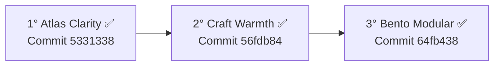

# ANELEC TCE — PROJECT PROGRESS & MEMORY CHEATSHEET
> **Purpose**: Single Source of Truth to track implementation status, design directions, module architectures, and technical workflows WITHOUT reading the entire repository. Read this file first before querying the codebase.

---

## 1. PROJECT PORTS & RUNNING SERVICES

| Service | Port | Directory | Task / Command | Role |
| :--- | :---: | :---: | :---: | :--- |
| **Mock Reference Gallery** | `3000` | `frontend/` | `npm run start` | Reference screens for Atlas, Craft, Bento, etc. |
| **Real App Client (Vite)** | `5173` | `client/` | `npx vite --port 5173` | The actual production React SPA |
| **API Backend (Express)** | `3001` | `server/` | `npx tsx server/index.ts` | REST API, WebSockets, Auth, Supabase bridge |
| **Database (Supabase)** | Remote | `qfhxptwsuotqnrihzhxw` | PostgreSQL 17 | `Suivi_ANELEC` project (users, devis, etc.) |

---

## 2. STATUS OF THE 3 ARTISTIC DIRECTIONS



| Direction | Token ID | Theme Key | Visual Mood | Status | Key Characteristics |
| :--- | :---: | :---: | :--- | :---: | :--- |
| **1. Atlas Clarity** | `atlas` | `atlas` | Linear / Stripe Enterprise | **100% Validated** | `#1D4ED8` blue, `#F6F7FB` cold neutral, Inter font, 10px cards, sidebar |
| **2. Craft Warmth** | `craft` | `craft` | Jobber / Notion Terroir | **100% Validated** | `#FAF7F2` linen, `#0F766E` teal, `#D97706` amber, Merriweather Sans, 22px cards, 999px pills, topbar |
| **3. Bento Modular** | `bento` | `bento` | Apple / Linear Modular | **100% Validated** | `#F2F3F5` gray, `#111827` dark tiles, `#F5B400` yellow, Sora font, 18px tiles, floating dock |

---

## 3. THE 4 MODULES / VOLETS IMPLEMENTATION MAPPING

All 11 platform screens are 100% ported and routed inside [`client/src/pages/DashboardPage.tsx`](client/src/pages/DashboardPage.tsx):

| Volet | URL Route | App Section ID | Active Studio Component | Key Features |
| :--- | :--- | :--- | :--- | :--- |
| **1. Espace de travail** | `/` | `aujourdhui` | [`DashboardSynthese.tsx`](client/src/components/dashboard/DashboardSynthese.tsx) | 4 KPIs, sparklines, urgences en cours, agenda du jour, jauges équipe |
| **1. Espace de travail** | `/planning` | `planning` | [`PlanningStudioView.tsx`](client/src/components/PlanningStudioView.tsx) | Gantt 07h-19h, ligne maintenant, bourse dispatch latérale, matrice semaine |
| **1. Espace de travail** | `/devis` | `devis` | [`DevisStudioView.tsx`](client/src/components/DevisStudioView.tsx) | Table 8 colonnes, tiroir inspection, conversion 1-clic vers intervention |
| **1. Espace de travail** | `/interventions` | `interventions` | [`InterventionsStudioView.tsx`](client/src/components/InterventionsStudioView.tsx) | Table & Kanban, filtres techniciens, bouton bleu Valider rapport, modal clôture |
| **1. Espace de travail** | `/carte` | `carte` | [`CarteStudioView.tsx`](client/src/components/CarteStudioView.tsx) | Leaflet CartoDB, bascule Positions/Trajet, panneau d'avancement, cockpit plein écran |
| **2. Gestion** | `/facturation` | `facturation` | [`FacturationStudioView.tsx`](client/src/components/FacturationStudioView.tsx) | 5 bacs alignés (À facturer, À vérifier, etc.), arbitrage fiscal TVA, diagnostic relance |
| **2. Gestion** | `/rentabilite` | `rentabilite` | [`ComptabiliteStudioView.tsx`](client/src/components/ComptabiliteStudioView.tsx) | 4 KPIs rentabilité, slider coût horaire chargé 25-60€, Recharts BarChart, leader |
| **2. Gestion** | `/clients` | `clients` | [`DonneursOrdreStudioView.tsx`](client/src/components/DonneursOrdreStudioView.tsx) | Grille clients B2B/B2C, tiroir fiches techniques, grilles tarifaires, modal ajout |
| **3. Espace Terrain** | `/mobile` | `mobile_tech` | [`TechnicianMobileView.tsx`](client/src/components/TechnicianMobileView.tsx) | Pointage matin/soir, carrousel 7 jours, fiches missions, photos avant/après, GPS |
| **4. Administration** | `/referentiels` | `referentiels` | [`ParametresStudioView.tsx`](client/src/components/ParametresStudioView.tsx) | Matrice techniciens × corps d'état 1-clic, barèmes horaires HT, chips métiers |
| **4. Administration** | `/admin` | `admin` | [`UtilisateursStudioView.tsx`](client/src/components/UtilisateursStudioView.tsx) | Console collaborateurs, matrice des droits par rôle (11 modules), pointages hebdo |

---

## 4. UI COMPONENT DESIGN SYSTEM (`client/src/components/ui/index.tsx`)

Reusable pure components adhering to `.m-*` classes:
* `Page`: Full page container with `eyebrow`, `title`, `description`, `actions`, `subnav`.
* `Card`: Clean bordered container with optional `head`, `actions`, `flush`.
* `Kpi`: Metric card with `label`, `value`, `sub`, `tone` (`blue`, `green`, `amber`, `red`, `indigo`), `icon`, `onClick`.
* `Btn`: Standard button (`primary`, `subtle`, `danger`, `xs`, `sm`, `lg`).
* `IconBtn`: Accessible icon-only button with label tooltip.
* `Pill` / `StatusPill`: High-visibility status tag with color tones.
* `KindTag`: Trade / type badges (`travaux`, `depannage`, `visite`, `urgence`).
* `Segmented`: iOS/Linear style segmented pill switch.
* `Dropdown`: Compact custom selector with popup menu.
* `SearchInput` & `Input`: Stylized input fields with iconography.
* `Switch`: Boolean toggle for settings and permissions.
* `Avatar`: Monogram or photo circle with fallback initials.
* `Progress`: Horizontal progress bar with tone variants.
* `DataTable`: Structured responsive data table.
* `Drawer`: Slide-over lateral inspection panel with Esc shortcut and backdrop.
* `Modal`: Centered overlay modal dialog.

---

## 5. CSS STYLESHEET ARCHITECTURE (`client/src/styles/`)

* `mock-design-system.css` (92.5 kB): Base rules for `.m-*` (cards, drawers, modals, buttons, kpis, tables).
* `atlas-clarity.css`: Variables for `[data-dir="atlas"]` / `[data-theme="atlas"]`.
* `craft-warmth.css`: Variables for `[data-dir="craft"]` / `[data-theme="craft"]`.
* `bento-modular.css`: Variables for `[data-dir="bento"]` / `[data-theme="bento"]`.
* `themes.css`: Legacy theme variable definitions & fallbacks.

Activated via `client/src/stores/themeStore.tsx`:
```ts
html.setAttribute('data-theme', id);
html.setAttribute('data-dir', id);
document.body.classList.add('m-body');
```

---

## 6. SCREENSHOT VALIDATION TESTS (Puppeteer Core)

To test all 11 screens without hitting the real backend or burning tokens:
* Atlas Clarity: `node scripts/capture_all_atlas_views.mjs`
* Craft Warmth: `node scripts/capture_all_craft_views.mjs`
* Bento Modular: `node scripts/capture_all_bento_views.mjs`

Saved output directory:
`C:\Users\Zeh\.gemini\antigravity\brain\d2fd77b6-f5a7-44a6-956a-412bdfedd8dd\`
Contains:
* `atlas-app-*.png` vs `atlas-mock-*.png` (11 screens)
* `craft-app-*.png` vs `craft-mock-*.png` (11 screens)
* `bento-app-*.png` vs `bento-mock-*.png` (11 screens)

---

## 7. BUILD VALIDATION

* Command: `npm run build:client`
* Standard result: `tsc && vite build` -> **Code 0**, ~2894 modules transformed in ~15.4s.
* Zero TypeScript errors.
