# 🏢 ANELEC GROUPE — Plateforme Intégrée TCE, Dispatching & Facturation

> **Progiciel d'Entreprise Tout Corps d'État (TCE)**  
> **Production Officielle :** [suivi.anelecgroupe.com](https://suivi.anelecgroupe.com)  
> **Version :** Production 2026 Stable & Homologuée  
> **📘 Manuel Opérationnel & Guide PDF Imprimable :** [`docs/GUIDE_UTILISATEUR_PROCEDURES_ANELEC_TCE.pdf`](docs/GUIDE_UTILISATEUR_PROCEDURES_ANELEC_TCE.pdf)

<p align="center">
  
</p>

---

## 📑 Sommaire Général

1. [Vue d'Ensemble & Architecture du Système](#1-vue-densemble--architecture-du-système)
2. [Ergonomie & Responsive Design : Version PC vs Version Téléphone](#2-ergonomie--responsive-design--version-pc-vs-version-téléphone)
3. [Le Nouveau Tableau de Bord (3 Volets Métier)](#3-le-nouveau-tableau-de-bord-3-volets-métier)
4. [Carte Interactive & Calcul Automatique d'Itinéraires (TSP 2-Opt)](#4-carte-interactive--calcul-automatique-ditinéraires-tsp-2-opt)
5. [Procédures Opérationnelles Pas-à-Pas Séparées par Métier](#5-procédures-opérationnelles-pas-à-pas-séparées-par-métier)
   * [Métier A : Direction Générale & Super-Admin](#procédure-a--direction-générale--super-admin-pilotage-financier)
   * [Métier B : Bureau d'Études & Chargé d'Affaires](#procédure-b--bureau-détudes--chiffrage-pipeline-devis)
   * [Métier C : Conducteur de Travaux & Dispatcher](#procédure-c--conducteur-de-travaux--dispatcher-planning-gantt--tournées)
   * [Métier D : Technicien Terrain (Mobile PWA)](#procédure-d--technicien-terrain-application-mobile-pwa)
   * [Métier E : Responsable Facturation & Comptabilité](#procédure-e--responsable-facturation--comptabilité-tri--fiscalité)
   * [Métier F : Inscription & Espace Entreprise](#procédure-f--inscription--activation-dun-nouvel-espace-entreprise-multi-tenant)
6. [Génération du Guide Utilisateur PDF Officiel](#6-génération-du-guide-utilisateur-pdf-officiel)
7. [Commandes Utiles & Stack Technique](#7-commandes-utiles--stack-technique)

---

## 1. Vue d'Ensemble & Architecture du Système

La plateforme **Suivi TCE ANELEC** fédère en temps réel l'ensemble de la chaîne opérationnelle d'ANELEC GROUPE : de la réception du besoin client (Syndics, Bailleurs, B2B, B2C), en passant par l'étude de prix, la visite de devis, l'ordonnancement des équipes, l'optimisation des trajets routiers, l'intervention sur smartphone, jusqu'à la facturation conforme et l'analyse de marge brute.

<p align="center">
  
</p>

```mermaid
flowchart LR
    A["📞 Demande Client<br/>(Syndic, Tertiaire, Particulier)"] --> B["📄 Pipeline Devis<br/>(Chiffrage & Visite VIS•DEV)"]
    B -->|Visite nécessaire| C["🟡 Visite Prise de Cotes<br/>(Créneau unifié calendrier)"]
    B -->|Accord client| D["🟢 Devis Accepté"]
    C --> D
    D --> E["🎯 Moteur Planning Gantt<br/>(Dispatch Techniciens)"]
    E --> F["🗺️ Carte & Tournées<br/>(Départ Siège 9 Rue des Colonnes)"]
    F --> G["📱 App Mobile Technicien<br/>(Pointage ☀️, Waze/Maps, Photos)"]
    G -->|Clôture terrain| H["🧾 Studio Facturation<br/>(5 Bacs de Tri & Arbitrage HT/TTC)"]
    H --> I["💰 Direction & Rentabilité<br/>(KPI Marges & Coût Moyen /h)"]
```

---

## 2. Ergonomie & Responsive Design : Version PC vs Version Téléphone

L'application a été auditée et optimisée à 100% sur **10 résolutions d'écrans représentatives de tous les ordinateurs et smartphones**, garantissant **0px de débordement horizontal** et **aucun texte ni bouton masqué**.

| Fonctionnalité | Version PC / Ordinateur Portable 🖥️ | Version Téléphone / Smartphone 📱 |
| :--- | :--- | :--- |
| **Navigation Principale** | Barre latérale gauche hiérarchisée (254px) en 3 blocs : *Espace de travail*, *Gestion*, *Administration*. | Barre inférieure fixée au bas de l'écran, conçue pour une utilisation facile au pouce. |
| **Barre d'En-tête (Topbar)** | Titre de section complet, barre de commande globale rapide (**Ctrl+K**), heure de Paris en direct, boutons d'action rapide (`+ Devis`, `+ Intervention`). | Barre épurée avec menu tiroir (hamburger), recherche compacte, bouton d'installation PWA et bascule mode sombre. |
| **Affichage des Données** | Grilles en double colonnes asymétriques (0.85fr / 1.15fr), visualisations graphiques larges. | Empilement fluide en colonne unique avec espacement de sécurité de **30px** au-dessus de la barre du bas. |
| **Tableaux Analytiques** | Vue pleine largeur avec colonnes détaillées et chiffres tabulaires alignés à droite. | Conteneurs tactiles défilants (`.table-scroll`) avec inertie sans jamais forcer l'élargissement de la page. |
| **Guidage Routier & Carte** | Vue grand angle du circuit routier complet, zoom interactif et fiches récapitulatives. | Lancement immédiat en 1 clic dans l'application GPS native du téléphone (**Waze** ou **Google Maps**). |

<p align="center">
  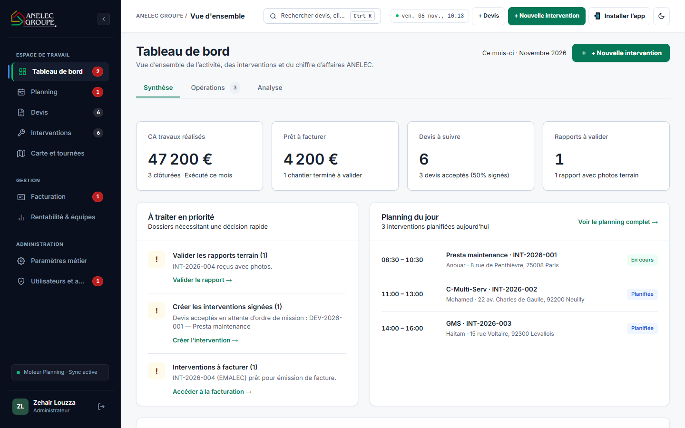
  
</p>

---

## 3. Le Nouveau Tableau de Bord (3 Volets Métier)

Le tableau de bord se divise en 3 sous-onglets spécialisés pour répondre aux besoins opérationnels et managériaux :

### ① Volet Synthèse — Le Baromètre Visuel Immédiat
* **4 Cartes KPI Principales :**
  - **CA travaux réalisés (€ HT) :** Chiffre d'affaires produit par les chantiers achevés dans le mois.
  - **Prêt à facturer (€ HT) :** Trésorerie mobilisable immédiatement (chantiers terminés en attente de facturation).
  - **Devis à suivre :** Nombre de chiffrages en cours d'étude et taux de concrétisation commerciale (%).
  - **Rapports à valider :** Signalements photos reçus du terrain nécessitant validation technique.
* **Double Colonne Opérationnelle :**
  - **À traiter en priorité :** Alertes cliquables vers les rapports photos reçus et devis signés à convertir.
  - **Planning du jour :** Déroulé chronologique des interventions prévues aujourd'hui avec pastille d'état (En cours, Planifiée).
* **Activité par corps d'état :** Tableau récapitulatif par spécialité (Électricité, Plomberie, Serrurerie, Peinture, Menuiserie, Tous corps d'état).

<p align="center">
  
</p>

---

### ② Volet Opérations — Les Files d'Action & Capacité des Équipes
* **4 Files de Traitement Opérationnel :**
  - **File 1 :** Devis acceptés à convertir en intervention.
  - **File 2 :** Visites et travaux à planifier dans le calendrier.
  - **File 3 :** Devis à relancer (échéance de relance atteinte).
  - **File 4 :** Interventions terminées prêtes pour la facturation.
* **Capacité & Affectation des Équipes :** Vue en temps réel de la charge de travail de chaque technicien (nombre de missions et chantiers assignés).
* **Signalements Photos Terrain :** Cartouche d'alerte dès qu'un technicien téléverse des photos justificatives d'un chantier terminé.

<p align="center">
  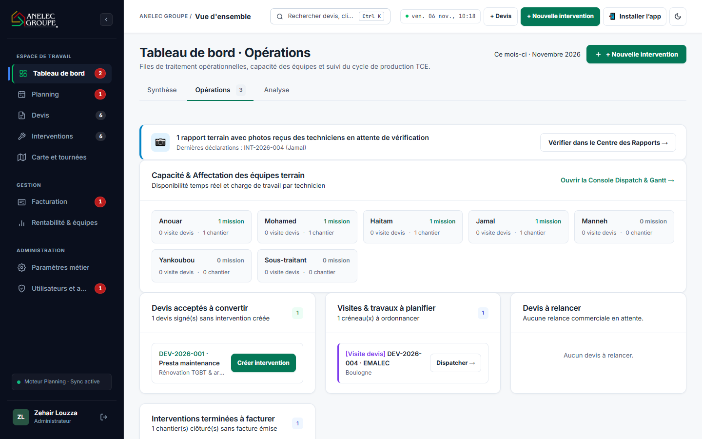
</p>

---

### ③ Volet Analyse — Entonnoir de Production & Performance Financière
* **L'Entonnoir d'Avancement des Travaux (5 Étapes Fluides) :**
  - **Étape 1 · Amont :** Devis & Chiffrages (devis actifs et visites requises).
  - **Étape 2 · Dispatch :** Ordonnancement Gantt (missions en attente de planification).
  - **Étape 3 · Production :** Sur le terrain aujourd'hui (chantiers avec pointage actif).
  - **Étape 4 · Contrôle :** Rapports & Photos reçus (vérification avant facturation).
  - **Étape 5 · Clôture :** Clôturées & Facturées (pourcentage de facturation effective).
* **Répartition Analytique par Pôle Métier :** Ventilation détaillée du CA réalisé, des chantiers actifs et du taux de complétion par corps d'état.

<p align="center">
  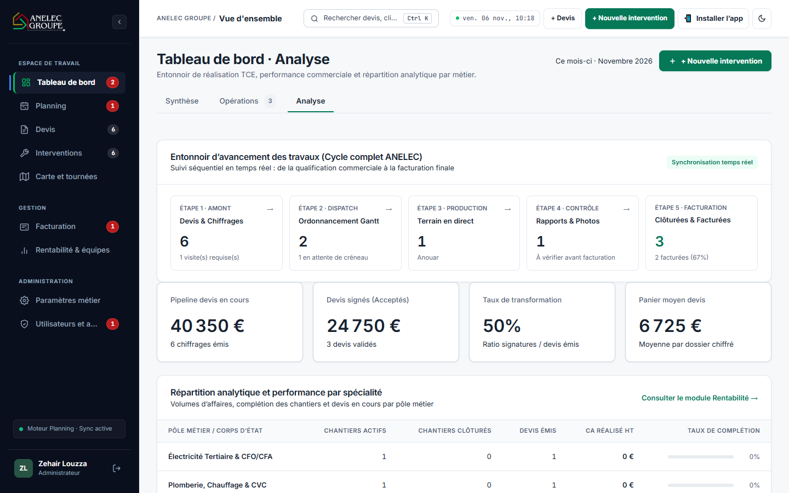
</p>

---

## 4. Carte Interactive & Calcul Automatique d'Itinéraires (TSP 2-Opt)

Le module **Carte & Tournées** calcule automatiquement le circuit routier le plus rapide pour minimiser les kilomètres et le temps de trajet des techniciens en Île-de-France.

<p align="center">
  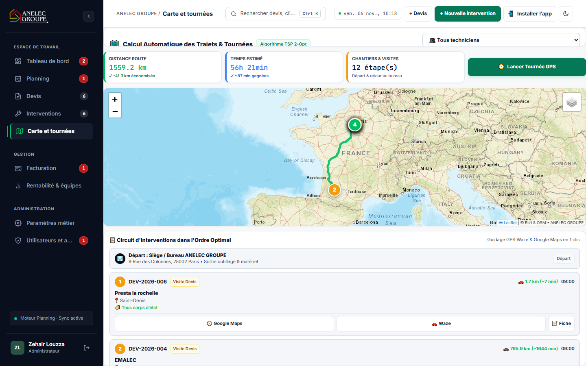
</p>

### 📍 Règle Métier Absolue : Départ et Arrivée Fixes au Siège ANELEC
> Le point de départ et d'arrivée de toutes les tournées est **strictement fixé au siège d'ANELEC GROUPE : 9 Rue des Colonnes, 75002 Paris**.  
> **Aucune localisation GPS personnelle** du technicien n'est utilisée pour tracer le parcours routier.

### 🛡️ Fiabilité Cartographique & Tuiles Haute Disponibilité
* Afin de prévenir tout blocage HTTP 403 d'OpenStreetMap, l'application utilise les serveurs cartographiques **ESRI World Street Map** (CDN mondial haute performance) avec bascule automatique sur **OpenStreetMap France** (`osmfr`).
* Affichage fluide des marqueurs géolocalisés via l'API nationale de géocodage (**Base Adresse Nationale - adresse.data.gouv.fr**).

### 🚀 Guidage GPS 1 Clic sur Mobile
Sur téléphone portable, chaque étape du circuit propose deux boutons d'action rapide :
* **Bouton Google Maps :** Ouvre l'itinéraire avec prise en compte du trafic en temps réel.
* **Bouton Waze :** Ouvre le guidage communautaire direct vers l'adresse exacte du chantier.

<p align="center">
  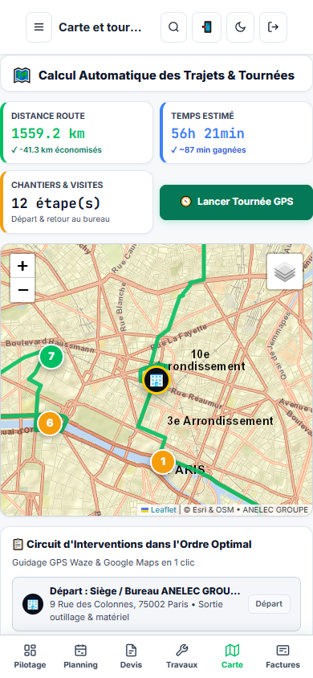
</p>

---

## 5. Procédures Opérationnelles Pas-à-Pas Séparées par Métier

---

### Procédure A : Direction Générale & Super-Admin (Pilotage Financier)

**Acteurs :** Direction, Gérant, Responsable Administratif et Financier.

<p align="center">
  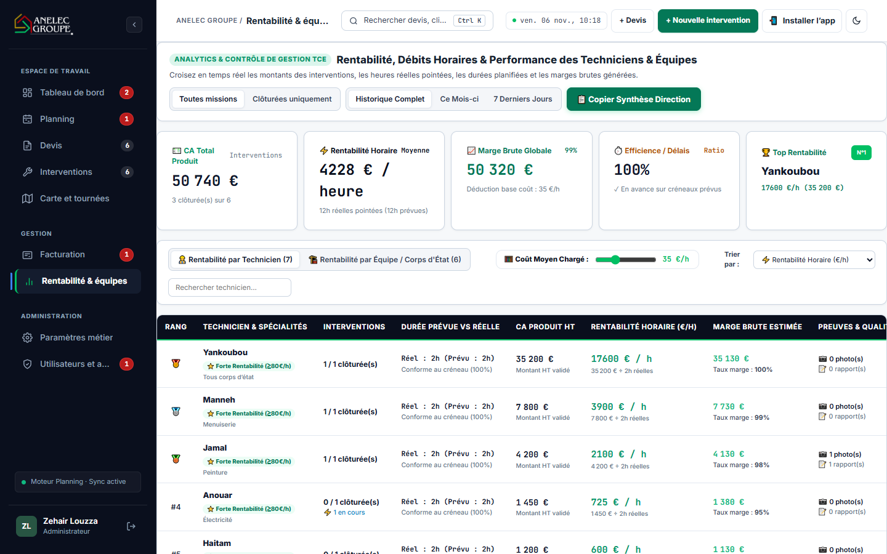
</p>

#### Étapes Opérationnelles :
1. **Étape 1 ➔ Consulter le Tableau de Bord (Volet Synthèse & Analyse) :**
   - Vérifier le volume de CA travaux réalisés dans le mois en cours.
   - Contrôler le taux de transformation commerciale des devis émis.
2. **Étape 2 ➔ Évaluer la Rentabilité Horaire Réelle (€ HT / heure) :**
   - Accéder à la section **Rentabilité & Équipes**.
   - Analyser le ratio `CA Produit HT / Heures Réelles Pointées`.
3. **Étape 3 ➔ Utiliser le Simulateur de Coût Moyen Chargé :**
   - Déplacer le curseur interactif du coût horaire de revient (ex: 35 €/h) pour observer immédiatement la marge nette dégagée par chaque technicien et chaque corps d'état.
4. **Étape 4 ➔ Auditer les Pointages Flotte :**
   - Dans **Utilisateurs & Accès**, consulter les relevés d'arrivée (☀️) et de départ (🌙) certifiés pour chaque salarié.

---

### Procédure B : Bureau d'Études & Chiffrage (Pipeline Devis)

**Acteurs :** Métreur, Chiffreur TCE, Chargé d'Affaires.

<p align="center">
  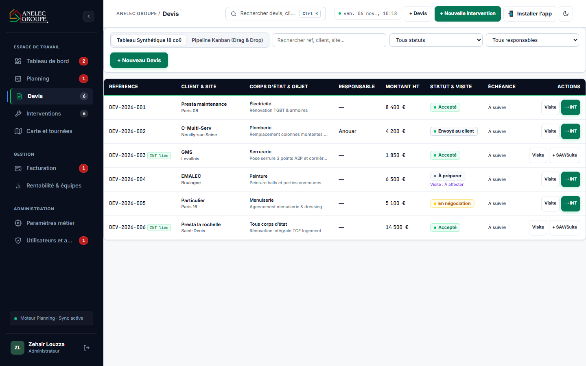
</p>

#### Étapes Opérationnelles :
1. **Étape 1 ➔ Créer un Devis Chiffrage :**
   - Cliquer sur le bouton **`+ Devis`** en haut à droite.
   - Renseigner le donneur d'ordre (Syndic, Bailleur, Client), l'adresse complète du chantier, l'objet des travaux et le corps d'état.
2. **Étape 2 ➔ Qualifier la Prise de Cotes :**
   - Si une visite préalable est nécessaire sur site, cocher la case **« Visite nécessaire »**.
   - Un créneau unifié **`VIS • DEV`** apparaît immédiatement dans la bourse du planning pour que le dispatcher attribue un technicien.
3. **Étape 3 ➔ Convertir le Devis Signé :**
   - Lorsque le devis est validé par le client, cliquer sur **« Convertir en intervention »**.
   - **Sécurité Anti-Doublon :** Si le devis a déjà été converti, la **Grille de Reconversion Intelligente** s'affiche automatiquement pour qualifier le motif :
     - 🛠️ **SAV / Garantie :** Intervention sous garantie non facturée (`[SAV]`).
     - 🔁 **Reprise de Travaux :** Correction d'inachevé ou malfaçon (`[REPRISE]`).
     - ➕ **Avenant / Travaux Sup :** Prestation supplémentaire commandée sur site (`[AVENANT]`).
     - 📅 **2ème Phase / Tranche :** Étape différée pour séchage ou corps d'état suivant (`[PHASE 2]`).

<p align="center">
  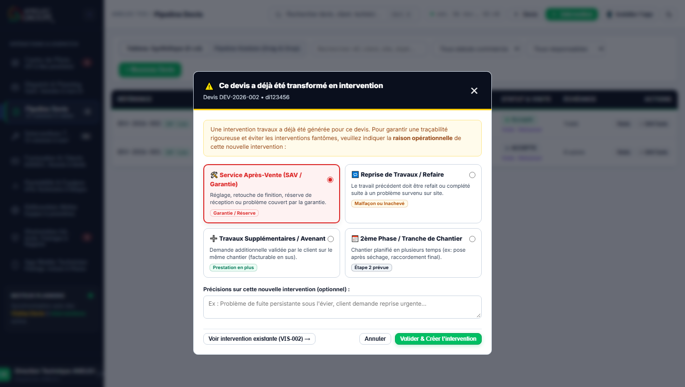
</p>

---

### Procédure C : Conducteur de Travaux & Dispatcher (Planning Gantt & Tournées)

**Acteurs :** Dispatcher, Conducteur de Travaux, Planificateur d'Équipe.

<p align="center">
  
</p>

#### Étapes Opérationnelles :
1. **Étape 1 ➔ Ouvrir la Bourse de Dispatch :**
   - Dans le menu **Planning**, ouvrir le tiroir latéral gauche contenant les missions non planifiées.
2. **Étape 2 ➔ Glisser-Déposer sur la Ligne du Technicien (Pointer Events 60 fps) :**
   - Déplacer le bloc mission sur la timeline du technicien compétent à l'horaire convenu (ex: 09h00).
   - Ajuster la durée de passage en étirant simplement le bord inférieur du bloc avec la souris.
3. **Étape 3 ➔ Vérifier le Circuit Routier dans « Carte & Tournées » :**
   - Basculer sur **Carte & Tournées**.
   - Sélectionner le technicien concerné : le système trace le circuit routier automatique au départ du siège (9 Rue des Colonnes) et vérifie l'absence d'incohérence kilométrique.

---

### Procédure D : Technicien Terrain (Application Mobile PWA)

**Acteurs :** Techniciens Électriciens, Plombiers, Serruriers, Peintres, Menuisiers et Polyvalents TCE.

<p align="center">
  
</p>

<p align="center">
  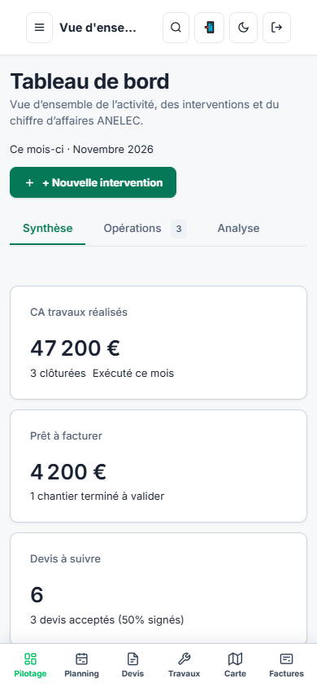
</p>

#### Étapes Opérationnelles :
1. **Étape 1 ➔ Pointage Obligatoire du Matin (07h30 au Siège) :**
   - À l'arrivée au bureau, ouvrir l'application sur le téléphone et appuyer sur :  
     **`☀️ Pointer mon arrivée au bureau`**
   - 🔒 **Règle de sécurité :** Le démarrage des chantiers est verrouillé tant que ce pointage certifié n'a pas été enregistré.
2. **Étape 2 ➔ Trajet & Guidage GPS :**
   - Ouvrir la première mission de la journée.
   - Appuyer sur le logo **Waze** ou **Google Maps** pour démarrer le guidage routier vers l'adresse exacte.
3. **Étape 3 ➔ Démarrage & Déclarations Terrain :**
   - Arrivé sur place, appuyer sur **« Démarrer l'intervention »**.
   - Cocher les actions techniques réalisées au fur et à mesure.
4. **Étape 4 ➔ Prise de Photos (Compression Automatique < 75 Ko) :**
   - Prendre les photos avant/après avec l'appareil photo du smartphone.
   - Le moteur de compression intégré réduit instantanément la photo sans perte de netteté pour un téléversement immédiat même en zone 3G/4G faible.
5. **Étape 5 ➔ Clôture avec Signature & Pointage du Soir :**
   - Recueillir la signature du client sur l'écran et appuyer sur **« Clôturer l'intervention »** (le devis lié est automatiquement synchronisé).
   - En fin de journée, appuyer sur **`🌙 Pointer ma fin de journée`**.

---

### Procédure E : Responsable Facturation & Comptabilité (Tri & Fiscalité)

**Acteurs :** Agent de Facturation, Comptable, Gestionnaire Administratif.

<p align="center">
  
</p>

<p align="center">
  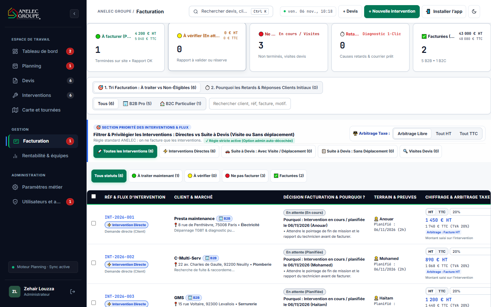
</p>

#### Règle d'Or Comptable d'ANELEC GROUPE :
> **« On ne facture que les chantiers achevés avec justificatifs validés, jamais un devis »**.  
> Les visites de devis de chiffrage (`VIS`) ne sont jamais envoyées en facturation.

#### Étapes Opérationnelles :
1. **Étape 1 ➔ Consulter le Bac 1 : 🟢 À facturer (Prêtes) :**
   - Seuls les chantiers clôturés avec rapport et photos conformes y figurent.
2. **Étape 2 ➔ Choisir le Régime Fiscal Approprié :**
   - **🏢 Régime B2B (Syndics, Bailleurs, Sociétés) :**
     - Saisie en **HT**.
     - Application de l'autoliquidation de sous-traitance TVA 0% (art. 283-2 nonies du CGI) ou TVA 20%.
     - Saisie obligatoire de la référence du Bon de Commande client.
   - **🏠 Régime B2C (Particuliers & Occupants) :**
     - Saisie en **TTC**.
     - Application du taux de TVA réduit à 10% (logement d'habitation > 2 ans) ou 5,5% (travaux d'amélioration énergétique).
3. **Étape 3 ➔ Émission & Bascule Automatique :**
   - Cliquer sur **« Émettre la facture »** : le dossier bascule instantanément dans le Bac **✅ Facturées** et met à jour le baromètre financier en temps réel.

---

### Procédure F : Inscription & Activation d'un Nouvel Espace Entreprise (Multi-Tenant)

**Acteurs :** Gérants d'entreprises partenaires, Artisans sous-traitants, Nouveaux utilisateurs.

<p align="center">
  
  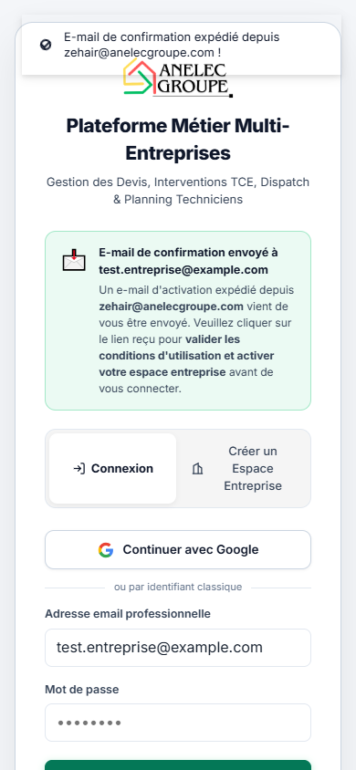
</p>

#### Étapes Opérationnelles Pas-à-Pas :
1. **Étape 1 ➔ Saisie des Informations de l'Entreprise :**
   - Depuis l'écran de connexion (sur mobile ou PC), cliquer sur l'onglet **« Créer un Espace Entreprise »**.
   - Renseigner la raison sociale de l'entreprise et son **numéro SIRET (14 chiffres)** ou **SIREN (9 chiffres)**.
   - Saisir le nom du responsable, l'adresse email professionnelle et un mot de passe sécurisé (8 caractères minimum).
   - Consulter et accepter les **Conditions Générales d'Utilisation (CGU)** et la **Politique de Confidentialité RGPD**.
2. **Étape 2 ➔ Soumission & Initialisation Automatique :**
   - Cliquer sur **« Créer mon espace entreprise »**.
   - Le système crée l'espace entreprise dédié avec étanchéité complète des données (Multi-Tenant PostgreSQL) et instancie automatiquement ses référentiels métier de base (corps d'état, origines, responsables).
3. **Étape 3 ➔ Confirmation & Activation par E-mail :**
   - Un e-mail d'activation sécurisé est expédié instantanément depuis **zehair@anelecgroupe.com** avec un lien chiffré unique.
   - L'écran affiche la bannière verte de confirmation `📩 E-mail de confirmation envoyé à ...` et bascule sur l'onglet de connexion en pré-remplissant l'adresse email.
   - En cliquant sur le lien reçu dans sa boîte mail, l'administrateur valide définitivement son compte et peut immédiatement se connecter à son espace de travail.

---

## 6. Génération du Guide Utilisateur PDF Officiel

Un script automatisé basé sur Chromium headless permet de compiler l'intégralité du manuel opérationnel en un document PDF A4 prêt à l'impression :

```sh
# Générer le Guide Utilisateur & Procédures Métier au format PDF
node scripts/generate-doc-pdf.mjs
```

Le fichier compilé est généré à l'emplacement suivant :  
👉 **`docs/GUIDE_UTILISATEUR_PROCEDURES_ANELEC_TCE.pdf`**

Ce document comprend :
* La page de couverture officielle avec le logo ANELEC GROUPE.
* Le sommaire détaillé avec numérotation des pages.
* Les schémas opérationnels de flux.
* Les captures d'écran réelles annotées avec pastilles de procédures (`①`, `②`, `③`), flèches directrices et explications visuelles.

---

## 7. Commandes Utiles & Stack Technique

### Stack Technique de Production
* **Frontend :** React 18, TypeScript, Vite, TanStack Query, Leaflet (Cartographie ESRI / OSM France).
* **Backend :** Node.js 20+, Express 4, Socket.io (Temps Réel).
* **Base de Données :** PostgreSQL 17 sur Supabase avec Session Pooler SSL.
* **ORM :** Prisma ORM v6.
* **Mobile :** PWA (Progressive Web App) installable avec Service Worker et Web App Manifest.
* **Infrastructure :** Hostinger Cloud VPS, déploiement Git sous Node.js.

### Commandes Opérationnelles de Développement

```sh
# 1. Installation des dépendances
npm ci --include=dev

# 2. Lancement en développement local (Vite + Serveur Express)
npm run dev

# 3. Compilation complète de production (Client Vite + Serveur TS)
npm run build

# 4. Application des migrations de base de données PostgreSQL
node scripts/migrate.mjs

# 5. Compilation du Guide Utilisateur PDF Officiel
node scripts/generate-doc-pdf.mjs
```

---

## Propriété Intellectuelle & Mentions Légales

© **ANELEC GROUPE** — 9 Rue des Colonnes, 75002 Paris.  
Tous droits réservés. Plateforme logicielle propriétaire de gestion de chantiers et dispatching Tout Corps d'État (TCE).
