# 🏢 ANELEC GROUPE — Plateforme de Suivi TCE, Dispatch & Facturation

> **Progiciel d'Entreprise Tout Corps d'État (TCE)**  
> **Production :** [suivi.anelecgroupe.com](https://suivi.anelecgroupe.com)  
> **Version :** Production 2026 Enterprise Stable  
> **Documentation Complète & Livre Blanc PDF :** [`docs/RAPPORT_COMPLET_TCE_ANELEC.pdf`](docs/RAPPORT_COMPLET_TCE_ANELEC.pdf)

<p align="center">
  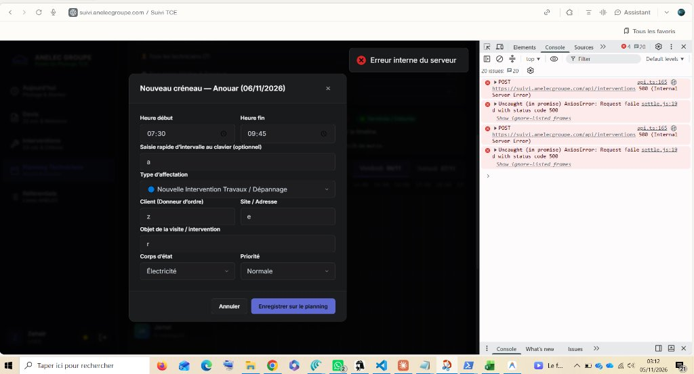
</p>

---

## 📑 Sommaire Général

1. [Vue d'Ensemble & Architecture Globale](#1-vue-densemble--architecture-globale)
2. [Centre de Pilotage & Baromètre Économique HT](#2-centre-de-pilotage--baromètre-économique-ht)
3. [Dispatching & Planning Gantt Pro Multi-Ressources](#3-dispatching--planning-gantt-pro-multi-ressources)
4. [Pipeline Devis & Grille de Reconversion Sécurisée](#4-pipeline-devis--grille-de-reconversion-sécurisée)
5. [Interventions TCE & Tableau Synthétique](#5-interventions-tce--tableau-synthétique)
6. [Facturation Intelligente & Arbitrage Fiscal (B2B vs B2C)](#6-facturation-intelligente--arbitrage-fiscal-b2b-vs-b2c)
7. [Contrôle de Gestion : Rentabilité & Marges d'Équipes](#7-contrôle-de-gestion--rentabilité--marges-déquipes)
8. [Workstation Super-Admin & Suivi des Pointages Flotte](#8-workstation-super-admin--suivi-des-pointages-flotte)
9. [Application Mobile Technicien PWA & Rigueur Terrain](#9-application-mobile-technicien-pwa--rigueur-terrain)
10. [Connexion Sécurisée & Contrôle d'Accès RBAC](#10-connexion-sécurisée--contrôle-daccès-rbac)
11. [Stack Technique & Déploiement Cloud](#11-stack-technique--déploiement-cloud)
12. [Fiches Réflexes & Manuel Opérationnel](#12-fiches-réflexes--manuel-opérationnel)

---

## 1. Vue d'Ensemble & Architecture Globale

La plateforme **Suivi TCE ANELEC** interconnecte l'ensemble de la chaîne de valeur opérationnelle d'ANELEC GROUPE, de la prise de contact initiale jusqu'à la facturation et l'analyse de rentabilité horaire.

<p align="center">
  
</p>

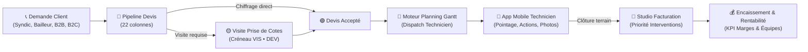

### Écosystème Technique
- **Poste Bureau / Direction :** Centre de pilotage, ordonnancement Gantt 60 fps, arbitrage de facturation, analyse de marges.
- **Application Smartphone PWA :** Pointage horodaté certifié serveur, déclarations terrain, compression photos < 75 Ko.
- **Serveur d'API & Temps Réel :** Node.js Express 4, Socket.io, hébergé sur Hostinger Cloud VPS.
- **Base de Données Cloud :** PostgreSQL 17 managé sur Supabase (Session Pooler SSL).

---

## 2. Centre de Pilotage & Baromètre Économique HT

Le **Centre de Pilotage** offre une vue synthétique à 360° sur la performance opérationnelle et financière de l'entreprise :


### Les 3 Niveaux d'Analyse

#### 1. Le Baromètre Financier (4 Cartes HT)
* **💰 CA Travaux Réalisés :** Cumul des chantiers achevés et clôturés (`#00bf63` Vert ANELEC).
* **📈 Pipeline Devis en Cours :** Potentiel commercial des devis en cours d'étude (`#ffcc00` Jaune ANELEC).
* **🧾 En-cours Prêt à Facturer :** Trésorerie immédiate à mobiliser (chantiers terminés prêts pour émission).
* **🎯 Taux de Transformation Commerciale (%) :** Ratio réel entre devis soumis et devis signés/réalisés.

#### 2. L'Entonnoir d'Avancement des Travaux (Cycle Complet ANELEC)
Suivi séquentiel en temps réel en 5 étapes fluides :
1. **Étape 1 : Devis & Chiffrages** (devis actifs + visites de prise de cotes).
2. **Étape 2 : Ordonnancement Gantt** (missions en attente de créneau).
3. **Étape 3 : Sur le Terrain Aujourd'hui** (chantiers actifs avec pointage en cours).
4. **Étape 4 : Rapports & Photos Reçus** (justificatifs terrain à valider).
5. **Étape 5 : Clôturées & Facturées** (taux de facturation effective des chantiers finis).

#### 3. Tableau de Bord d'Avancement par Pôle Métier (Corps d'État)
Répartition analytique des volumes, de l'état d'avancement et du CA réalisé pour chaque spécialité :
* **⚡ Électricité Tertiaire & CFO/CFA**
* **🔧 Plomberie, Chauffage & CVC**
* **🔑 Serrurerie, Accès & Dépannage**
* **🎨 Peinture, Ravalement & Finition**
* **🪟 Menuiserie, Faux Plafond & Agencement**
* **🏗️ Rénovation Complète & Multi-TCE**

---

## 3. Dispatching & Planning Gantt Pro Multi-Ressources

Le module de planification Gantt permet de gérer en temps réel les emplois du temps des techniciens et des équipes :

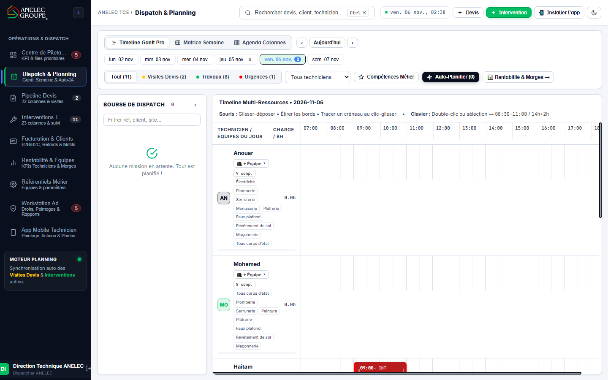

### Caractéristiques Majeures
* **Glisser-Déposer Haute Performance (Pointer Events 60 fps) :** Déplacement direct d'une mission d'une heure à une autre ou d'un intervenant à un autre.
* **Redimensionnement à la Souris :** Ajustement direct de la durée de passage en étirant le bord inférieur du bloc.
* **Créneau Unifié Visite & Devis (`VIS • DEV`) :**
  - Un rendez-vous physique = un seul créneau sur le calendrier.
  - Plus de blocs doublons empilés : les heures du technicien sont exactes à 100%.
  - L'inspecteur latéral affiche simultanément la fiche devis et le compte-rendu technique.
* **Bourse de Dispatch & Auto-Planification Assistée par IA :** Analyse des compétences requises et placement automatique sans conflit.
* **Actions Rapides :** Possibilité de *Déplanifier* (renvoyer en bourse) ou *Supprimer* un créneau en 1 clic.

---

## 4. Pipeline Devis & Grille de Reconversion Sécurisée

Gestion des 22 colonnes analytiques des devis de la prise de contact jusqu'à la signature :

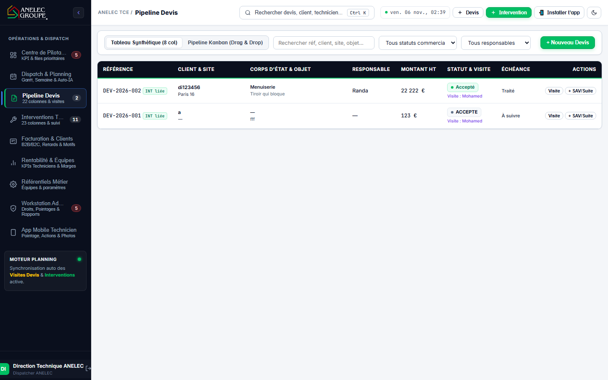

### La Grille de Reconversion Intelligente
Pour garantir une traçabilité rigoureuse et éviter les interventions fantômes en doublon, la reconversion d'un devis déjà traité est interceptée :

<p align="center">
  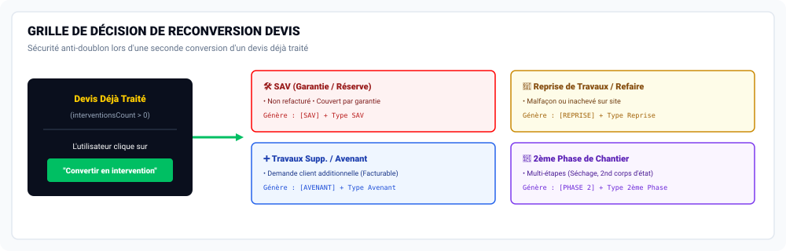
</p>


* **🛠️ Service Après-Vente (SAV / Garantie) :** Réglage, retouche de finition, réserve de réception. Intervention sous garantie, non refacturée (Préfixe `[SAV]`).
* **🔁 Reprise de Travaux / Refaire :** Correction d'une malfaçon ou inachevé sur site (Préfixe `[REPRISE]`).
* **➕ Travaux Supplémentaires / Avenant :** Prestation additionnelle commandée par le donneur d'ordre sur le chantier (Facturable en sus, préfixe `[AVENANT]`).
* **📅 2ème Phase / Tranche de Chantier :** Étape différée pour séchage ou deuxième corps d'état (Préfixe `[PHASE 2]`).
* **👁️ Consulter l'intervention existante :** Bouton direct permettant de consulter l'intervention en cours sans en créer une nouvelle.

---

## 5. Interventions TCE & Tableau Synthétique

Le tableau des interventions offre une lisibilité instantanée sur grand écran comme sur PC portable sans débordement horizontal :

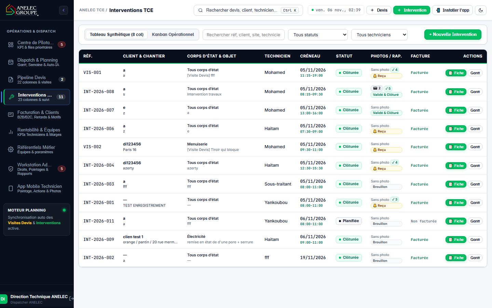

* **RÉF. :** Identifiant d'intervention (`INT-2026-XXX`) ou de visite (`VIS-XXX`).
* **CLIENT & CHANTIER :** Donneur d'ordre, adresse et ville.
* **CORPS D'ÉTAT & OBJET :** Spécialité et descriptif des travaux.
* **TECHNICIEN & CRÉNEAU :** Affectation et plage horaire exacte.
* **STATUT :** Badges colorés clairs (Planifiée, En cours, Clôturée).
* **PHOTOS / RAP. :** Compteur de photos prises sur le chantier et état de validation du rapport.
* **FACTURE :** État de transmission comptable.
* **ACTIONS :** Raccourcis fiche détaillée et vue sur le Gantt.

---

## 6. Facturation Intelligente & Arbitrage Fiscal (B2B vs B2C)

La gestion de la facturation applique la règle standard d'ANELEC GROUPE : **« On ne facture que les chantiers achevés, pas les devis »**.

<p align="center">
  
</p>

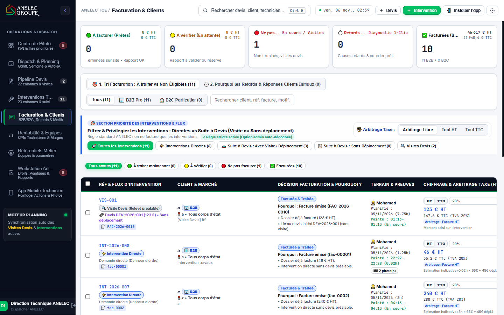

### Les 5 Bacs de Tri Facturation
1. **🟢 À facturer (Prêtes) :** Interventions de travaux terminées, rapport validé et photos conformes.
2. **🟡 À vérifier (En attente) :** Travaux finis par le technicien en attente de validation du métré.
3. **🔴 Ne pas facturer :** Visites de devis de chiffrage, interventions en cours, SAV sous garantie.
4. **⚠️ Retards Clients :** Factures émises ayant dépassé l'échéance (J+30 ou J+45).
5. **✅ Facturées :** Dossiers finalisés, transmis en comptabilité générale ou réglés.

### Arbitrage Fiscal Libre (B2B vs B2C)
* **🏢 Régime B2B (Syndics, Bailleurs, Professionnels) :** Saisie prioritaire en **HT**. Gestion de l'autoliquidation de sous-traitance (TVA 0% art. 283-2 nonies) ou TVA 20%, mention du Bon de Commande, paiement à 30 ou 45 jours.
* **🏠 Régime B2C (Particuliers & Occupants) :** Saisie prioritaire en **TTC**. TVA réduite 10% (rénovation > 2 ans) ou 5,5% (énergétique), règlement au comptant.

---

## 7. Contrôle de Gestion : Rentabilité & Marges d'Équipes

Tableau de bord financier croisant en temps réel les heures pointées, les durées planifiées et les montants validés :

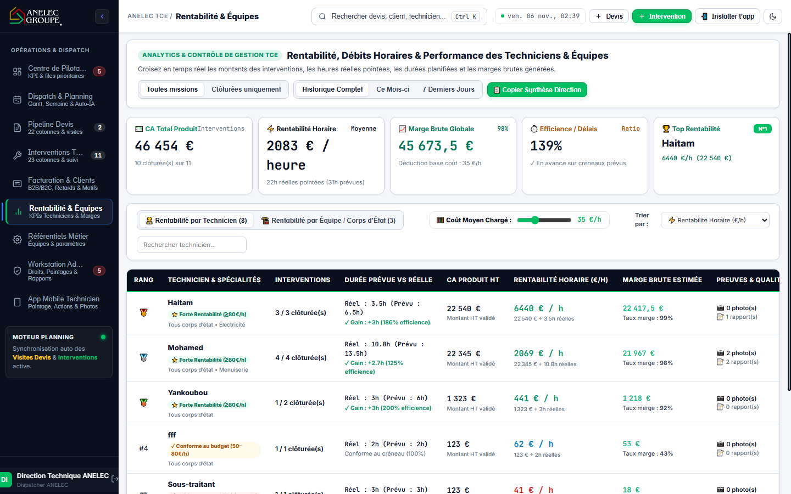

* **CA Total Produit (€ HT) :** Chiffre d'affaires total généré par les chantiers terminés.
* **Rentabilité Horaire (€ HT / heure) :** `CA Produit HT / Heures Réelles Pointées`.
* **Marge Brute Globale (€ et %) :** CA HT déduit du coût horaire et des fournitures.
* **Simulateur de Coût Moyen Chargé :** Curseur interactif permettant d'ajuster le coût de revient (ex: 35 €/h) pour recalculer la rentabilité nette de l'entreprise.
* **Classement par Technicien :** Suivi individuel des heures réelles vs prévues, gains d'efficience et qualité des livrables.

---

## 8. Workstation Super-Admin & Suivi des Pointages Flotte

Console de commandement et d'audit pour la direction :

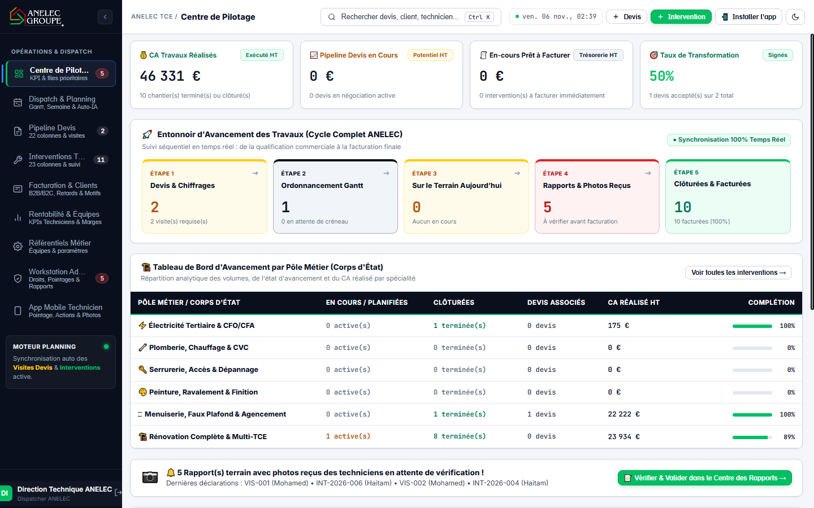

* **Matrice RBAC Granulaire :** Gestion fine des droits d'accès (`SUPER_ADMIN`, `ADMIN`, `CHIFFRAGE_DEVIS`, `CONDUCTEUR_TRAVAUX`, `TECHNICIEN`, `VIEWER`).
* **Tableau de Suivi des Pointages Journaliers :** Relevé chronologique des arrivées au bureau et départs le soir de l'ensemble de la flotte avec calcul automatique de l'amplitude travaillée.
* **Centre de Rédaction des Rapports Officiels :** Fusion en 1 clic des actions déclarées, horaires et photos du technicien dans le rapport officiel ANELEC.

---

## 9. Application Mobile Technicien PWA & Rigueur Terrain

Conçue pour un usage intensif à une main sur smartphone (PWA installable sur iOS et Android) :

<p align="center">
  
</p>

<p align="center">
  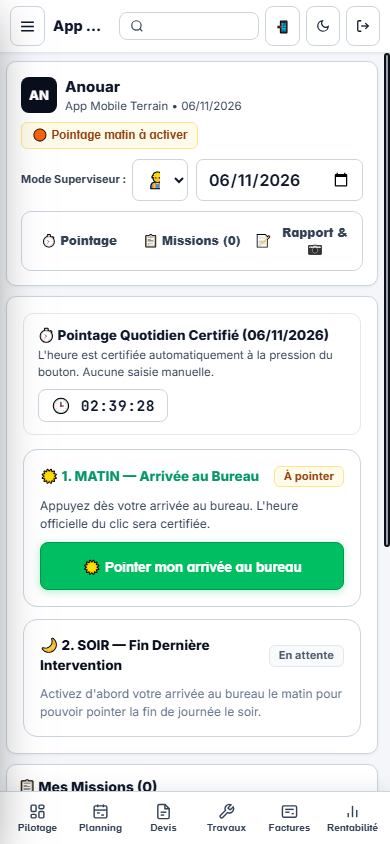
</p>

### Règles Opérationnelles Strictes
1. **Verrouillage du Matin :** L'application empêche de démarrer une mission sans avoir au préalable appuyé sur *« ☀️ Pointer mon arrivée au bureau »*. L'horodatage serveur est certifié et infalsifiable.
2. **Déclarations Terrain & Photos :** Cocher en 1 clic les actions techniques réalisées.
3. **Optimiseur de Photos (< 75 Ko) :** Les photos haute résolution prises sur site sont automatiquement redimensionnées et compressées avant l'envoi, garantissant un téléversement instantané en 3G/4G et protégeant la base de données.
4. **Clôture Synchronisée Devis & Intervention :** La clôture du chantier met automatiquement à jour le devis d'origine rattaché.
5. **Verrouillage du Soir & Mission Non Finie :** Le pointage de fin de journée est bloqué si une mission est en cours. En cas d'intempérie ou de pièce manquante, le technicien appuie sur *« Intervention non finie »* pour transmission immédiate au dispatcher.

---

## 10. Connexion Sécurisée & Contrôle d'Accès RBAC

L'accès à la plateforme est protégé par authentification JWT avec cookies sécurisés et étanchéité complète des profils :

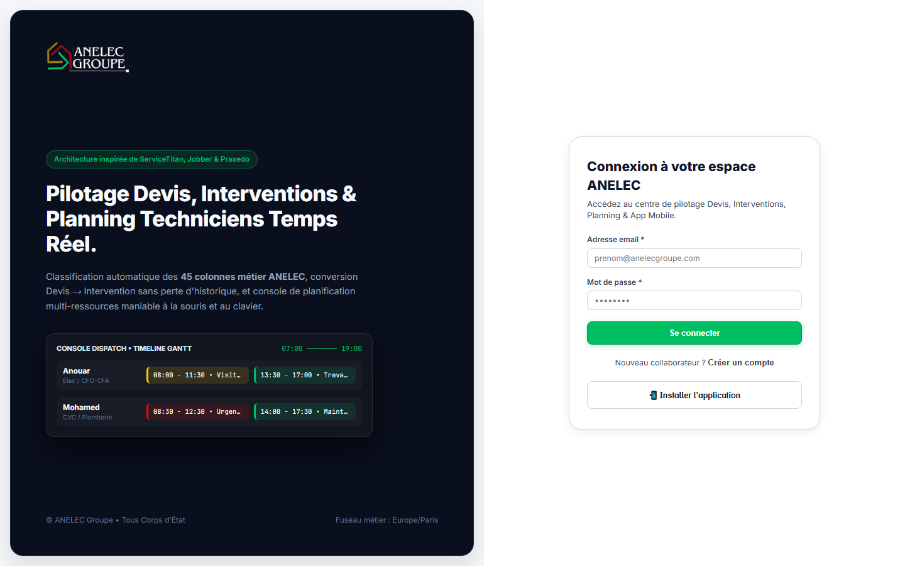

---

## 11. Stack Technique & Déploiement Cloud

| Couche | Technologie | Rôle et Caractéristiques |
|:---|:---|:---|
| **Frontend** | React 18, TypeScript, Vite, TanStack Query | Interface réactive 60 fps, mise en cache optimisée |
| **Backend** | Node.js 20+, Express 4, Socket.io | API REST, gestion des websockets temps réel |
| **Base de Données** | PostgreSQL 17 sur Supabase (AWS Paris) | SGBD relationnel sécurisé avec Session Pooler SSL |
| **ORM** | Prisma ORM v6 | Schéma déclaratif, typage strict et migrations |
| **Mobile PWA** | Web App Manifest, Service Worker | PWA certifiée installable sur iPhone et Android |
| **Production** | Hostinger Cloud VPS, Domaine Officiel | Déploiement automatisé sur `suivi.anelecgroupe.com` |

### Commandes Opérationnelles

```sh
# Installation des dépendances
npm ci --include=dev

# Lancement en développement (Vite + Serveur Express)
npm run dev

# Tests unitaires et non-régression temps réel
npx tsx --test test/realtimeInvalidation.test.ts

# Compilation complète de production
npm run build:client && npm run build:server

# Application des migrations Prisma en production
node scripts/migrate.mjs

# Génération du Livre Blanc PDF officiel
node scripts/generate-doc-pdf.mjs
```

---

## 12. Fiches Réflexes & Manuel Opérationnel

### Fiche Réflexe A : Le Dispatcher (Planning Gantt)
1. Ouvrir **Dispatch & Planning**.
2. Glisser la mission depuis la *Bourse* vers la timeline du technicien à l'heure voulue.
3. Pour ajuster la durée : étirer le bord inférieur du bloc.
4. Les visites devis apparaissent sous un seul bloc `VIS • DEV` en Jaune ANELEC.
5. Pour annuler : clic sur le créneau ➔ *« Supprimer le créneau »*.

### Fiche Réflexe B : Le Bureau d'Études (Pipeline Devis)
1. Ouvrir **Pipeline Devis**.
2. Si une prise de cotes est requise sur place, cocher *« Visite nécessaire »*.
3. Une fois signé par le client, cliquer sur *« Convertir en intervention »*.
4. Si déjà converti : la **Grille de Reconversion** s'affiche pour qualifier la mission (SAV, Reprise, Avenant ou Phase 2).

### Fiche Réflexe C : Le Technicien Terrain (Mobile PWA)
1. À l'arrivée au bureau (07h30) : appuyer sur *« ☀️ Pointer mon arrivée au bureau »*.
2. Sur le chantier : appuyer sur *« Démarrer l'intervention »*.
3. Prendre les photos (compressées automatiquement < 75 Ko) et cocher les actions réalisées.
4. À la fin : appuyer sur *« Clôturer l'intervention »* (le devis lié se clôture automatiquement).
5. Si un problème survient : appuyer sur *« Intervention non finie »* et préciser le motif.
6. En fin de journée : appuyer sur *« 🌙 Pointer ma fin de journée »*.

### Fiche Réflexe D : L'Agent de Facturation
1. Ouvrir **Facturation & Clients**.
2. Consulter le bac **🟢 À facturer (Prêtes)** : seules les interventions de travaux achevées y sont présentes.
3. Sélectionner le régime fiscal :
   - **Régime B2B :** Saisie en HT, autoliquidation ou TVA 20%, mention du Bon de Commande.
   - **Régime B2C :** Saisie en TTC, TVA réduite 10% ou 5,5%.
4. Valider l'émission : le dossier bascule immédiatement dans **Facturées**.

---

## 13. Documentation & Livre Blanc PDF

Le rapport exécutif complet au format PDF regroupe l'intégralité des visuels réels et des schémas techniques dans un format imprimable :
👉 **Télécharger le PDF :** [`docs/RAPPORT_COMPLET_TCE_ANELEC.pdf`](docs/RAPPORT_COMPLET_TCE_ANELEC.pdf)

---

## Propriété Intellectuelle

© **ANELEC GROUPE** — Tous droits réservés.  
Plateforme logicielle propriétaire conçue pour la maintenance et les travaux Tout Corps d'État (TCE).
