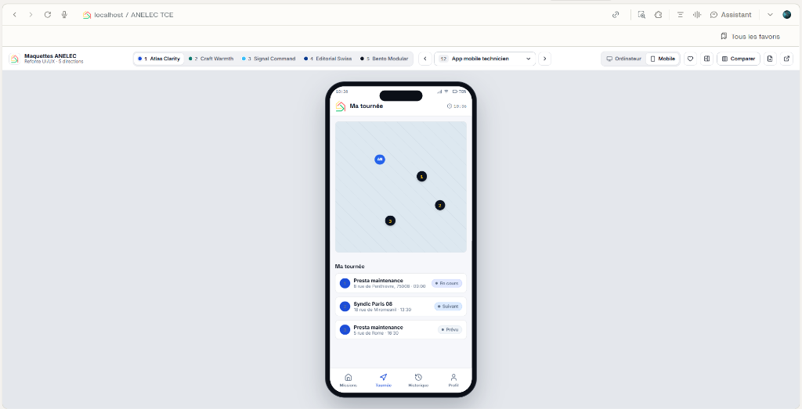

<p align="center">
  
</p>

<h1 align="center">ANELEC SUIVI TCE — Plateforme de Chiffrage de Devis, Automatisation &amp; Pilotage Chantier</h1>

<p align="center">
  <strong>Progiciel SaaS Multi-Entreprises Tous Corps d'État (TCE) · Chiffrage de devis · Visites techniques · Automatisation · Planning Gantt · App Mobile PWA</strong><br />
  Production officielle : <a href="https://suivi.anelecgroupe.com"><strong>suivi.anelecgroupe.com</strong></a> · Architecture Node.js / React / PostgreSQL 17 (Supabase)
</p>

<p align="center">
  
  
  
  
</p>

---

## Sommaire

1. [Vue d'Ensemble &amp; Chaîne de Valeur TCE](#1-vue-densemble--chaîne-de-valeur-tce)
2. [Onboarding Entreprise, Multi-Tenant &amp; Identité Créateur](#2-onboarding-entreprise-multi-tenant--identité-créateur)
3. [Tableau de Bord Décisionnel &amp; Situation Excel Multi-Clients](#3-tableau-de-bord-décisionnel--situation-excel-multi-clients)
4. [Chiffrage de Devis, Visite Technique Préalable &amp; Conversion Idempotente](#4-chiffrage-de-devis-visite-technique-préalable--conversion-idempotente)
5. [Charte PDF Vague-Nuage &amp; Compression Haute Qualité (PDF + Photos Terrain)](#5-charte-pdf-vague-nuage--compression-haute-qualité-pdf--photos-terrain)
6. [Automatisations Métier &amp; Liens Clients Sécurisés (Devis &amp; Rapports)](#6-automatisations-métier--liens-clients-sécurisés-devis--rapports)
7. [Planning Gantt Multi-Ressources &amp; Bourse de Dispatch](#7-planning-gantt-multi-ressources--bourse-de-dispatch)
8. [Application Mobile Technicien (PWA), Tournées &amp; Clôture GPS](#8-application-mobile-technicien-pwa-tournées--clôture-gps)
9. [Carte Interactive, Facturation B2B/B2C &amp; Rentabilité](#9-carte-interactive-facturation-b2bb2c--rentabilité)
10. [Gouvernance RBAC (5 Profils), SEO &amp; Référencement IA (GEO/AIO)](#10-gouvernance-rbac-5-profils-seo--référencement-ia-geoaio)
11. [Installation, Scripts, Tests &amp; Documentation Technique](#11-installation-scripts-tests--documentation-technique)

---

## 1. Vue d'Ensemble & Chaîne de Valeur TCE

**ANELEC SUIVI TCE** centralise en temps réel l'ensemble du cycle opérationnel des entreprises du bâtiment Tous Corps d'État (TCE), d'électricité générale, CVC, plomberie et maintenance multitechnique :

* **Avant-vente & Chiffrage :** réception des demandes clients, organisation de la **Visite Technique Préalable (Usage Interne)** pour relever les contraintes terrain, puis **chiffrage de devis** structuré.
* **Automatisations de flux :** envoi sécurisé des devis et rapports par lien unique signé, relances automatiques ouvrées (J+3 / J+7), alertes automatiques techniciens et conversion idempotente devis → chantier.
* **Exécution terrain & Temps réel :** planning Gantt par compétences, optimisation de tournées sur carte Leaflet, application mobile PWA (pointage horodaté, géolocalisation GPS, photos terrain compressées MozJPEG).
* **Pilotage financier :** studio de facturation B2B/B2C, extraction comptable **Situation Excel** multi-clients, analyse de rentabilité horaire et tableaux de bord multi-axes.

<p align="center">
  
</p>

---

## 2. Onboarding Entreprise, Multi-Tenant & Identité Créateur

### 2.1 Création d'Espace Entreprise & Multi-Entreprises par E-mail
Depuis `/login`, chaque entreprise provisionne son espace cloisonné en moins d'une minute :
* **Inscription classique ou Google OAuth 2.0 :** renseignement de la raison sociale, validation stricte du **SIRET (14 chiffres) / SIREN (9 chiffres)**, acceptation contractuelle des CGU / Politique RGPD (horodatée avec IP) et confirmation par code / lien e-mail.
* **Multi-entreprises native :** une même adresse e-mail peut détenir un compte indépendant dans plusieurs entreprises distinctes (unicité sur `(email, companyId)`), avec sélection sécurisée de l'entreprise **uniquement après validation du mot de passe ou du jeton Google**.

<p align="center">
  
</p>

<p align="center">
  
  
</p>

### 2.2 Cloisonnement PostgreSQL & Identité Créateur Signée en Dur
* **Isolation stricte par `companyId` :** toutes les entités métier (`devis`, `interventions`, `demandes`, `pointages_techniciens`, `referentiels`, `notifications`, `company_mail_settings`) sont filtrées côté serveur à chaque requête via l'identifiant société extrait du JWT vérifié.
* **Identité créateur canonique :** les coordonnées du créateur de la plateforme (`PLATFORM_CREATOR` dans `shared/types.ts`) sont vérifiées par e-mail et téléphone normalisé E.164 et persistées dans la table protégée par RLS `public.platform_creator` — indépendamment de tout identifiant auto-incrémenté.

<p align="center">
  
</p>

---

## 3. Tableau de Bord Décisionnel & Situation Excel Multi-Clients

Le **Tableau de Bord** propose 3 volets métier (*Synthèse*, *Opérations*, *Analyse*) et un pilotage par donneur d'ordre :
* **4 indicateurs financiers clés :** *CA Global HT*, *CA Facturé HT*, *Reste à Facturer HT* et *Panier Moyen HT / taux d'achèvement*.
* **Filtres instantanés :** Année, Mois, Jour exact, Donneur d'Ordre et bascule **Chiffre d'Affaires (€) / Volume d'activité**.
* **Export « Situation Excel » (`.xlsx`) :** sélection de plage de dates exacte (`Du` / `Au`) avec raccourcis rapides et cochage multi-clients pour générer un classeur comptable prêt à transmettre.

<p align="center">
  
  
</p>

<p align="center">
  
</p>

---

## 4. Chiffrage de Devis, Visite Technique Préalable & Conversion Idempotente

<p align="center">
  
</p>

* **Visite Technique Préalable (Usage Interne) :** avant d'éditer un devis, les équipes techniques documentent le constat sur site, les mesures, contraintes d'accès et photos terrain dans un module interne dédié générant un **rapport PDF de Visite Technique Préalable (Usage Interne)** pour fiabiliser le chiffrage sans exposition client.
* **Chiffrage & Pipeline Devis :** gestion des montants HT/TTC, délais de validité, taux de TVA, statuts commerciaux (`À préparer`, `À valider en interne`, `Envoyé au client`, `Accepté`, `Refusé`, `En négociation`, `Expiré`) et historique horodaté complet.
* **Conversion Devis → Intervention Idempotente :** toute conversion d'un devis accepté en chantier passe par `convertKeepingQuote` avec clé d'idempotence (`Idempotency-Key`), conservant intégralement le devis d'origine et qualifiant les reconversions multiples (SAV, Reprise, Avenant, 2ème Phase).

---

## 5. Charte PDF Vague-Nuage & Compression Haute Qualité (PDF + Photos Terrain)

Tous les documents officiels générés par la plateforme respectent la **charte ANELEC GROUPE** :
* **Identité visuelle unifiée :** en-tête organique en **vague-nuage**, logotype blanc vectorisé sur fond transparent, typographie claire sur fonds doux lisibles, et rappel encadré de l'adresse officielle `https://suivi.anelecgroupe.com` en en-tête et pied de page.
* **Gabarits couverts :**
  1. Devis commercial client (`devisPdf.ts`)
  2. Rapport d'intervention officiel (`rapportPdf.ts`)
  3. Rapport de Visite Technique Préalable — Usage Interne (`visiteTechniquePdf.ts`)
* **Compression avancée sans perte visuelle perceptible :**
  * **Flux PDF (`pdfCompression.ts`) :** déduplication et réencodage adaptatif des flux et images embarquées lors de la génération comme lors du dépôt manuel de PDF client.
  * **Photos de chantier (`imageOptimizer.ts` + `terrainPhotos.ts`) :** pré-optimisation dans le navigateur avant envoi puis recompression serveur **MozJPEG (`sharp`)** afin de réduire drastiquement le stockage tout en préservant la précision des relevés terrain.

---

## 6. Automatisations Métier & Liens Clients Sécurisés (Devis & Rapports)

<p align="center">
  
</p>

La plateforme intègre trois moteurs d'automatisation paramétrables par entreprise (détails de recette dans [`docs/RECETTE_ROLES.md`](docs/RECETTE_ROLES.md)) :

1. **Automatisation A — Affectation & Réponse Technicien :** notification immédiate à l'affectation (`À confirmer`), acceptation ou refus motivé obligatoire depuis le mobile, relance in-app paramétrable et escalade automatique (application + e-mail) vers le planificateur et la direction, avec option de pause week-end.
2. **Automatisation B — Devis Client par Lien Sécurisé :** dépôt de PDF ou génération automatique, sélection explicite des destinataires depuis la fiche client, page publique sans compte client (consultation PDF, acceptation, refus motivé ou demande de modification), relances J+3 / J+7 (lun.–sam. 8 h–19 h), expiration à 30 jours et révocation immédiate du lien en cas de modification substantielle.
3. **Automatisation C — Rapport Client par Lien Sécurisé :** accessible uniquement lorsque le rapport est `Validé & Clôturé` en interne ; sélection granulaire photo par photo des visuels transmissibles ; validation ou formulation de réserves motivées par le client (aucune validation tacite automatique à l'échéance des 30 jours).

---

## 7. Planning Gantt Multi-Ressources & Bourse de Dispatch

<p align="center">
  
</p>

* **Vue Gantt 07 h – 19 h temps réel :** visualisation claire par technicien et corps d'état, barre temporelle courante et indicateurs visuels de charge.
* **Bourse de Dispatch latérale :** affectation en glisser-déposer des interventions et visites techniques en attente, avec redimensionnement direct de la durée.

---

## 8. Application Mobile Technicien (PWA), Tournées & Clôture GPS

Installable sur iOS et Android comme application web progressive (PWA) et utilisable à une main sur le terrain, l'interface mobile s'articule autour de **4 onglets tactiles** :

<p align="center">
  
  
  
  
</p>

<p align="center">
  
  
</p>

* **Missions & Pointage horodaté :** boutons *Commencer / Finir la journée*, navigation jour/semaine/mois, fiches d'intervention avec accès GPS/téléphone, compte-rendu et capture de photos Avant / Après compressées.
* **Ma tournée (Leaflet temps réel) :** carte d'itinéraire ordonnée depuis le dépôt jusqu'aux différents chantiers de la journée.
* **Historique & Profil :** archivage des interventions clôturées, compteurs hebdomadaires et personnalisation de l'apparence selon la politique définie par l'entreprise.
* **Clôture certifiée par GPS :** relevé de coordonnées et rayon de précision lors de la clôture, avec retrait immédiat de l'étape sur la carte générale de tournée.

---

## 9. Carte Interactive, Facturation B2B/B2C & Rentabilité

### 9.1 Carte Interactive & Suivi de Tournées (`/carte`)

<p align="center">
  
  
</p>

* Bascule immédiate entre **Positions actuelles techniciens**, **Trajet restant optimisé**, et **Vue combinée**, avec mode **Cockpit Plein Écran PC**.

### 9.2 Studio Facturation, Clients & Administration SMTP

<p align="center">
  
  
</p>

<p align="center">
  
  
  
</p>

* **Facturation 5 bacs :** *À facturer*, *À vérifier*, *Non éligibles*, *Retards & Relances (Diagnostic 1-clic)* et *Facturées* avec gestion fiscale B2B/B2C (autoliquidation 0 %, 20 %, 10 %, 5,5 %).
* **Donneurs d'ordre & Rentabilité :** fiches techniques multi-destinataires (devis / rapports / facturation), grilles tarifaires par corps d'état et simulateur de coût horaire chargé.
* **Console Admin :** gestion des rôles et permissions, invitations e-mail, configuration SMTP dédiée par société chiffrée côté serveur, et audit hebdomadaire des pointages.

---

## 10. Gouvernance RBAC (5 Profils), SEO & Référencement IA (GEO/AIO)

### 10.1 Rôles & Cloisonnement Serveur (« Deny by Default »)
Les autorisations sont vérifiées à chaque appel API dans `server/lib/guard.ts` et bornées par des plafonds stricts par rôle (`ROLE_DEFINITIONS` dans `shared/types.ts`) :

| Code Rôle | Libellé | Accès Principal |
| :--- | :--- | :--- |
| `ADMIN` | Direction | Gouvernance totale de l'entreprise, utilisateurs, SMTP, facturation, suppressions |
| `CHIFFRAGE_DEVIS` | Chargé d'études (chiffrage) | Devis, visites de chiffrage, conversion devis → intervention |
| `CONDUCTEUR_TRAVAUX` | Planificateur | Demandes, planning Gantt, carte, interventions et affectation techniciens |
| `REDACTEUR_RAPPORTS` | Rapports et facturation | Relecture et envoi sécurisé des rapports clients, facturation et donneurs d'ordre |
| `TECHNICIEN` | Technicien | Application mobile PWA uniquement, sur ses seules missions (sans montants) |

### 10.2 SEO & Référencement Moteurs IA (GEO / AIO)
* **Découverte exhaustive :** `/robots.txt` ouvert aux principaux moteurs web (`Googlebot`, `Bingbot`, `Qwantbot`, `DuckDuckBot`, `YandexBot`, `Baiduspider`, `Applebot`) et moteurs IA (`GPTBot`, `OAI-SearchBot`, `ChatGPT-User`, `PerplexityBot`, `ClaudeBot`, `Google-Extended`, `meta-externalagent`, `MistralAI-User`, `xAI-Bot`, etc.) tout en protégeant `/api/`, `/devis-client/`, `/rapport-client/` et `/invitation` (`Disallow` + `X-Robots-Tag: noindex`).
* **Ressources sémantiques IA :** `/llms.txt`, `/llms-full.txt`, `/.well-known/ai-plugin.json`, `/sitemap.xml` et données structurées JSON-LD `@graph` (`WebSite`, `Organization`, `SoftwareApplication`, `FAQPage`) optimisées autour des mots-clés **chiffrage de devis**, **automatisation**, **visite technique préalable** et **suivi TCE**.

---

## 11. Installation, Scripts, Tests & Documentation Technique

### 11.1 Démarrage Local Rapide

```sh
# 1. Installer les dépendances (inclut devDependencies)
npm ci --include=dev

# 2. Configurer les variables d'environnement à partir du modèle
cp .env.example .env

# 3. Générer le client Prisma et lancer l'environnement de développement
npx prisma generate
npm run dev
```

### 11.2 Build, Migrations & Tests Automatisés

```sh
# Compilation complète de production (Client Vite + Serveur Express TypeScript)
npm run build

# Démarrage production (utilisé sur Hostinger)
node scripts/start.mjs

# Application manuelle contrôlée des migrations PostgreSQL / Supabase
node scripts/migrate.mjs

# Suite E2E complète des rôles, isolation multi-entreprises et automatisations A/B/C
npm run test:roles

# Tests unitaires ciblés (accès, créateur, liens clients, workflows, mots de passe)
npx tsx --test test/creatorIdentity.test.ts test/accessRules.test.ts test/devisClient.test.ts test/rapportClient.test.ts test/workflowAutomation.test.ts test/passwordPolicy.test.ts
```

### 11.3 Index de la Documentation

| Document | Contenu |
| :--- | :--- |
| [`docs/ARCHITECTURE_TECHNIQUE.md`](docs/ARCHITECTURE_TECHNIQUE.md) | Stack, organisation du dépôt, multi-tenant, RBAC, moteur PDF/MozJPEG et SEO/GEO |
| [`docs/DEPLOIEMENT_ET_EXPLOITATION.md`](docs/DEPLOIEMENT_ET_EXPLOITATION.md) | Configuration Hostinger + Supabase, variables d'env, procédure Prisma 5 et check-list prod |
| [`docs/RECETTE_ROLES.md`](docs/RECETTE_ROLES.md) | Cahier de recette détaillé des 5 rôles, automatisations A/B/C et multi-entreprises |
| [`docs/GUIDE_UTILISATEUR_PROCEDURES_ANELEC_TCE.pdf`](docs/GUIDE_UTILISATEUR_PROCEDURES_ANELEC_TCE.pdf) | Manuel opérationnel complet illustré au format PDF |
| [`docs/DOSSIER_PDF_MAQUETTES.md`](docs/DOSSIER_PDF_MAQUETTES.md) | Documentation du dossier PDF de la galerie de maquettes UI/UX isolée (`frontend/`) |

---

<p align="center">
  © 2026 <strong>ANELEC GROUPE SAS</strong> — 9 Rue des Colonnes, 75002 Paris · SIREN 933 108 607 · Tous droits réservés.<br />
  Contact technique &amp; éditeur : Zehair Louzza (<a href="mailto:louzza.zehair@gmail.com">louzza.zehair@gmail.com</a> · <a href="tel:+33628618628">+33 6 28 61 86 28</a>)
</p>
