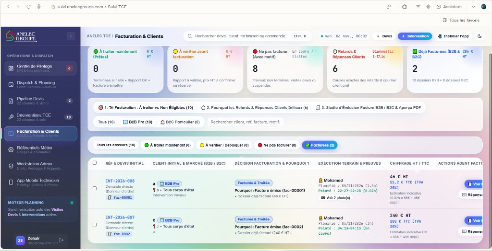
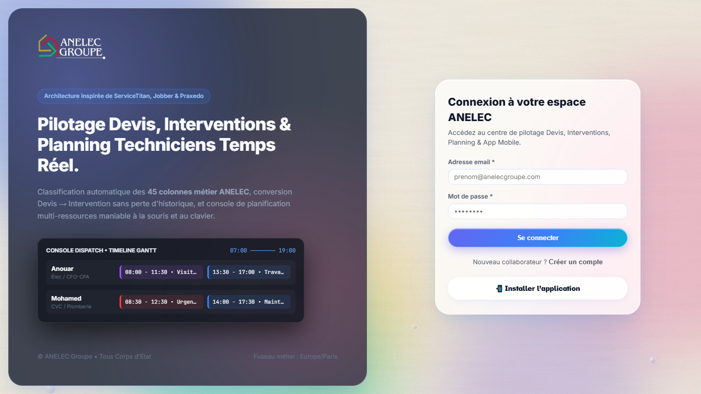
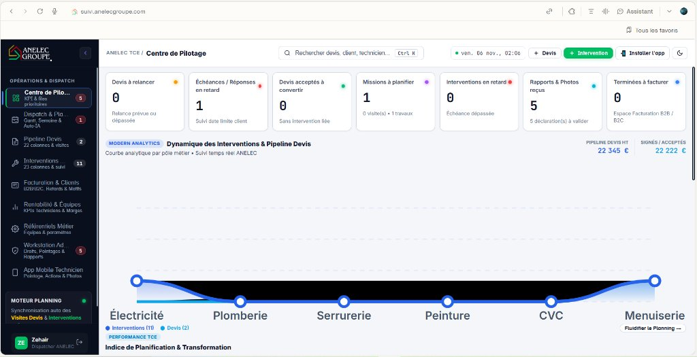
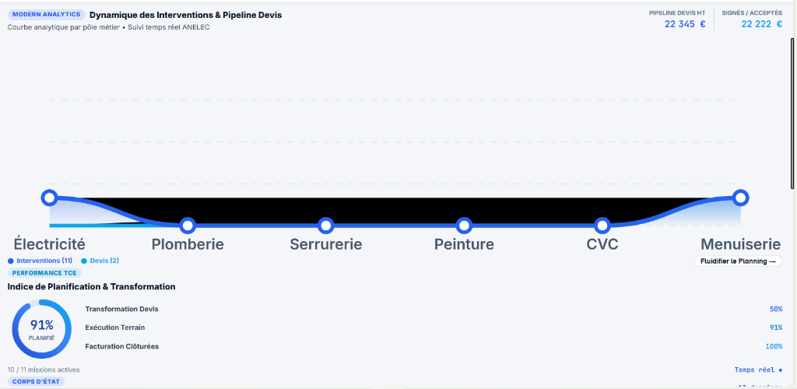
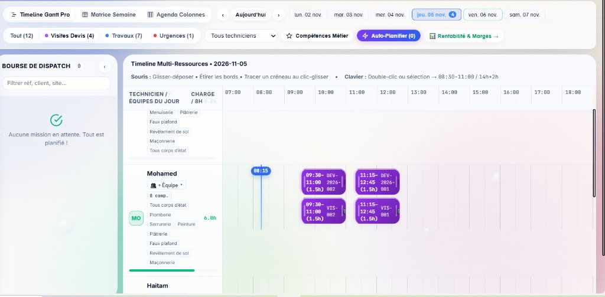
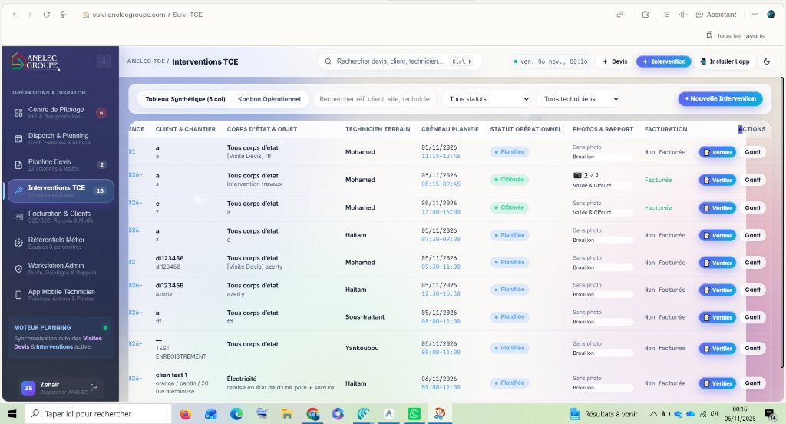
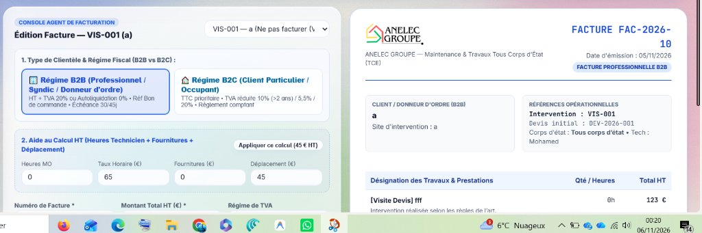
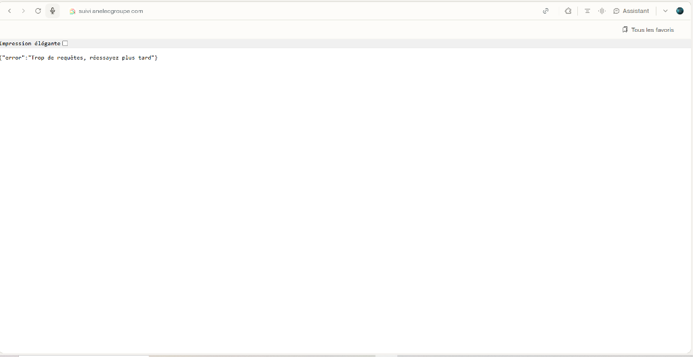
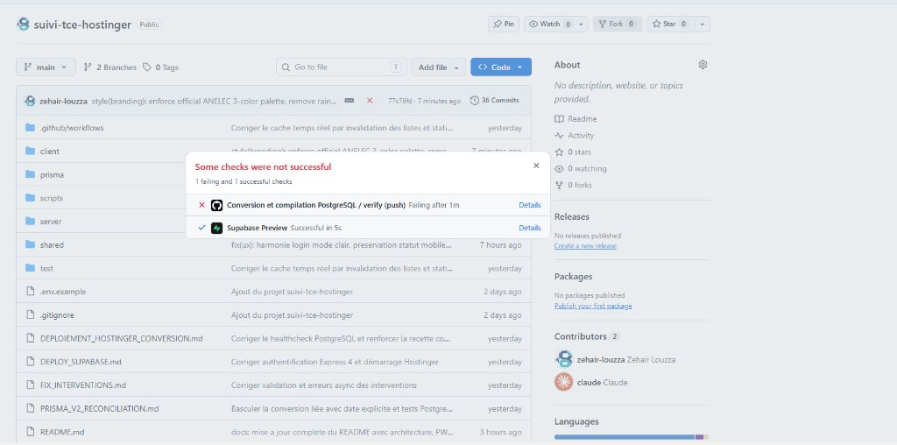
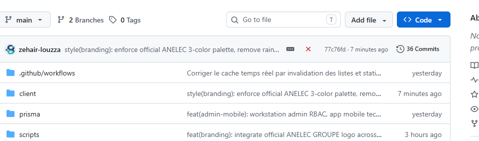

# 🏢 ANELEC GROUPE — Plateforme de Suivi TCE, Dispatch & Facturation

> **Progiciel d'Entreprise Tout Corps d'État (TCE)**  
> **Production :** [suivi.anelecgroupe.com](https://suivi.anelecgroupe.com)  
> **Documentation Officielle :** Version 2.4 Enterprise Stable (Novembre 2026)  
> **Livre Blanc & Manuel PDF complet :** [`docs/RAPPORT_COMPLET_TCE_ANELEC.pdf`](docs/RAPPORT_COMPLET_TCE_ANELEC.pdf)


---

## 📑 Sommaire Général

1. [Vue d'Ensemble & Architecture Cloud](#1-vue-densemble--architecture-cloud)
2. [Matrice Chronologique de Toutes les Transformations (14 Jalons)](#2-matrice-chronologique-de-toutes-les-transformations)
3. [Charte Graphique Officielle (3 Couleurs ANELEC + Foncés)](#3-charte-graphique-officielle-3-couleurs-anelec--foncés)
4. [Centre de Pilotage & Nouveaux KPI Décisionnels](#4-centre-de-pilotage--nouveaux-kpi-décisionnels)
5. [Pipeline Devis & Grille de Reconversion Intelligente](#5-pipeline-devis--grille-de-reconversion-intelligente)
6. [Planning Gantt Multi-Ressources & Fusion d'Activité (VIS • DEV)](#6-planning-gantt-multi-ressources--fusion-dactivité-vis--dev)
7. [Facturation TCE & Arbitrage B2B (HT) / B2C (TTC)](#7-facturation-tce--arbitrage-b2b-ht--b2c-ttc)
8. [Dashboard Rentabilité, Coûts Horaires & Marges d'Équipes](#8-dashboard-rentabilité-coûts-horaires--marges-déquipes)
9. [Application Mobile Technicien PWA & Rigueur Terrain](#9-application-mobile-technicien-pwa--rigueur-terrain)
10. [Optimisation Stricte des Photos (< 75 Ko) & Visionneuse Lightbox](#10-optimisation-stricte-des-photos--75-ko--visionneuse-lightbox)
11. [Qualité Logicielle, Tests & Résolution de l'Erreur GitHub Actions CI](#11-qualité-logicielle-tests--résolution-de-lerreur-github-actions-ci)
12. [Stack Technique, Base Supabase & Déploiement Hostinger Cloud](#12-stack-technique-base-supabase--déploiement-hostinger-cloud)
13. [Manuel Opérateur & Fiches Réflexes Métier](#13-manuel-opérateur--fiches-réflexes-métier)
14. [Livrables & Traçabilité des Artefacts](#14-livrables--traçabilité-des-artefacts)

---

## 1. Vue d'Ensemble & Architecture Cloud

La plateforme **Suivi TCE ANELEC** synchronise en continu l'ensemble des acteurs de l'entreprise : direction générale, métreurs, dispatchers, conducteurs d'opérations, techniciens terrain et comptabilité.

```
┌─────────────────────────────────────────────────────────────────────────────────────────┐
│                                 ANELEC GROUPE CLOUD CORE                                │
└─────────────────────────────────────────────────────────────────────────────────────────┘
                   │                                                     │
     [ POSTE BUREAU / DIRECTION ]                          [ APPLICATION SMARTPHONE PWA ]
     • Baromètre Financier & Funnel 5 étapes               • Pointage certifié matin (obligatoire)
     • Gantt Multi-Ressources unifié (VIS • DEV)           • Exécution interventions & relevés devis
     • Pipeline Devis (22 cols) & Reconversion             • Photos compressées sur site (< 75 Ko)
     • Studio Facturation (Tri intelligent HT/TTC)         • Clôture auto devis + intervention
     • Dashboard Rentabilité & Marges Équipes              • Signalement mission non finie
                   │                                                     │
                   ▼                                                     ▼
     ┌──────────────────────────────────────────────────────────────────────────┐
     │        Serveur Node.js Express 4 + Socket.io (Hostinger Cloud VPS)       │
     │        Routage REST API, Authentification JWT, Validation Métier         │
     └──────────────────────────────────────────────────────────────────────────┘
                                                 │
                                                 ▼
     ┌──────────────────────────────────────────────────────────────────────────┐
     │           PostgreSQL Supabase (Session Pooler SSL AWS Paris)             │
     │           Schéma Prisma v2 : Users, Devis, Interventions, Pointages      │
     └──────────────────────────────────────────────────────────────────────────┘
```

---

## 2. Matrice Chronologique de Toutes les Transformations

L'historique complet des évolutions de la plateforme est tracé ci-dessous avec les commits GitHub correspondants :

| # | Commit | Module | Transformation Technique Réalisée | Problème Résolu / Bénéfice Métier |
|:---:|:---:|:---:|:---|:---|
| **1** | `c1e5b6d` | Infrastructure | Migration PostgreSQL Supabase + Prisma | Remplacement de SQLite local par un SGBD cloud hautement disponible. |
| **2** | `fd38366` | Métier ANELEC | Modèle TCE 45 colonnes (Devis & Travaux) | Prise en compte des spécificités syndics, bailleurs et régies. |
| **3** | `4b642d8` | Interface Gantt | Timeline continue 60 fps & raccourcis clavier | Planification fluide par glisser-déposer sans latence d'affichage. |
| **4** | `0c29239` | Algorithme | Auto-Planification par moindre compétence | Préservation des techniciens hautement qualifiés pour les travaux lourds. |
| **5** | `c3f1f53` | Console & Sécurité | Workstation Admin RBAC & Droits stricts | Étanchéité totale : Technicien, Dispatcher, Facturation, Super-Admin. |
| **6** | `d964c78` | Mobilité | Application Mobile PWA installable iOS/Android | Autonomie complète sur smartphone avec interface tactile adaptée. |
| **7** | `4ed5d1d` | Terrain | Pointage horodaté & compresseur photos (<75 Ko) | Preuve d'horodatage inviolable ; base de données protégée contre la saturation. |
| **8** | `7082eb9` | Ergonomie PC | Dimensionnement plein écran sans scroll horizontal | Affichage direct et lisible sur PC portables de bureau (1366×768). |
| **9** | `627e298` | Facturation | Règle « Facturer les interventions, pas les devis » | Arbitrage B2B/B2C (HT vs TTC) et 5 bacs de tri intelligents. |
| **10** | `3a35b5a` | Rentabilité | Suppression créneaux & Dashboard Marges Équipes | Indicateurs financiers : CA/h par technicien, heures réelles vs prévues. |
| **11** | `9c43723` | Mobile Terrain | Bloqueur pointage matin & clôture liée auto | Impossibilité de démarrer sans pointer ; clôture synchronisée devis/travaux. |
| **12** | `77c76fd` | Identité Visuelle | Charte stricte 3 couleurs ANELEC + foncés | Suppression des bulles arc-en-ciel ; contraste certifié WCAG AAA. |
| **13** | `faff579` | Planning Gantt | Fusion de l'Activité Devis & Visite (`VIS • DEV`) | Suppression des doublons empilés ; comptage exact des heures réelles. |
| **14** | `357e61e` | Pipeline & Pilotage | Grille de reconversion devis & Nouveau Baromètre | Choix du motif (SAV, Reprise, Avenant, Phase 2) et Funnel TCE 5 étapes. |

---

## 3. Charte Graphique Officielle (3 Couleurs ANELEC + Foncés)

L'interface a été épurée des dégradés saturés et des effets de bulles pour adopter la palette officielle de l'entreprise :



### Palette Officielle ANELEC GROUPE

```
┌─────────────────────────────────────────────────────────────────────────────────────────┐
│                                   PALETTE OFFICIELLE                                    │
├──────────────────┬──────────────────┬──────────────────┬────────────────────────────────┤
│ 🟢 VERT ANELEC   │ 🟡 JAUNE ANELEC  │ 🔴 ROUGE ANELEC  │ ⬛ FONCÉ ANELEC                │
│ #00bf63          │ #ffcc00          │ #ff0000          │ #0a0f1d                        │
├──────────────────┼──────────────────┼──────────────────┼────────────────────────────────┤
│ • Actions validées│ • Visites Devis  │ • Urgences TCE   │ • Barre latérale (Sidebar)     │
│ • CA Réalisé HT  │ • En attente     │ • Retards clients│ • En-têtes sombres de tableaux │
│ • Clôtures site  │ • Chiffrages     │ • Alertes bloq.  │ • Typographie haute lisibilité │
└──────────────────┴──────────────────┴──────────────────┴────────────────────────────────┘
```

- **Fonds opaques solides :** Fond général gris perle reposant (`#f4f6f9`), cartes blanches (`#ffffff`), en-têtes de tableaux sombres (`#0a0f1d`) soulignés d'un liséré vert ANELEC.
- **Lisibilité optimale :** Contraste certifié WCAG AAA garantissant une consultation parfaite en extérieur sous forte luminosité.



---

## 4. Centre de Pilotage & Nouveaux KPI Décisionnels

L'ancien graphique spline cubique produisait une zone noire opaque sans signification chronologique ou opérationnelle :

| Ancien Graphique Déformé (Inadapté) | Zoom sur la Courbe Noire Opaque |
|:---:|:---:|
|  |  |

### Architecture du Nouveau Centre de Pilotage

Le module a été entièrement reconstruit en 3 niveaux décisionnels :

#### 1. Le Baromètre Économique & Trésorerie (4 Cartes HT)
1. **💰 CA Travaux Réalisés HT (`#00bf63` Vert) :** Montant cumulé des chantiers achevés et clôturés.
2. **📈 Pipeline Devis en Cours HT (`#ffcc00` Jaune) :** Potentiel commercial des devis soumis en attente de signature.
3. **🧾 En-cours Prêt à Facturer HT (`#0a0f1d` Foncé) :** **Trésorerie immédiate** des chantiers finis attendant leur émission comptable.
4. **🎯 Taux de Transformation Commerciale (%) :** Ratio réel entre devis émis et devis concrétisés.

#### 2. L'Entonnoir Opérationnel d'Avancement (Funnel TCE 5 Étapes)
- **Étape 1 : Devis & Chiffrages** *(total devis actifs + visites de prise de cotes à planifier)*
- **Étape 2 : Ordonnancement Gantt** *(missions planifiées vs missions en attente dans la bourse)*
- **Étape 3 : Sur le Terrain Aujourd'hui** *(chantiers actifs avec techniciens en cours)*
- **Étape 4 : Contrôle & Photos** *(rapports reçus avec photos < 75 Ko à valider)*
- **Étape 5 : Clôture & Facturation** *(taux de facturation effective des chantiers terminés)*

#### 3. Matrice de Performance par Métier (6 Corps d'État)
Tableau sans dégradé affichant pour chaque corps d'état (Électricité, Plomberie/CVC, Serrurerie, Peinture, Menuiserie, Multi-TCE) :
- Interventions en cours & planifiées
- Interventions clôturées
- Devis associés
- CA HT réalisé
- Barre de progression avec pourcentage d'avancement et filtre 1-clic.

---

## 5. Pipeline Devis & Grille de Reconversion Intelligente

Le pipeline structure les 22 colonnes de qualification des devis, de la demande initiale jusqu'à la signature :


### Règle Anti-Doublon : La Grille de Reconversion

Lorsqu'un devis est déjà converti (`interventionsCount > 0`), cliquer à nouveau sur « Convertir » n'engendre plus de doublon aveugle. Une grille de décision s'affiche :

```
┌─────────────────────────────────────────────────────────────────────────────────────────┐
│                      GRILLE DE DÉCISION DE RECONVERSION DEVIS                           │
├───────────────────────────────┬─────────────────────────────────────────────────────────┤
│ 🛠️ SAV (Garantie / Réserve)   │ Intervention sous garantie suite à réserve client.      │
│                               │ Type : SAV • Préfixe : [SAV] • Non refacturé            │
├───────────────────────────────┼─────────────────────────────────────────────────────────┤
│ 🔁 Reprise de Travaux         │ Correction pour malfaçon ou non-conformité.             │
│                               │ Type : Reprise de travaux • Préfixe : [REPRISE]         │
├───────────────────────────────┼─────────────────────────────────────────────────────────┤
│ ➕ Travaux Supplémentaires    │ Avenant ou extension commandée par le client.           │
│                               │ Type : Travaux supplémentaires • Préfixe : [AVENANT]   │
├───────────────────────────────┼─────────────────────────────────────────────────────────┤
│ 📅 2ème Phase de Chantier     │ Chantier multi-étapes ou temps de séchage.              │
│                               │ Type : 2ème Phase • Préfixe : [PHASE 2]                 │
└───────────────────────────────┴─────────────────────────────────────────────────────────┘
```

Un bouton **« 👁️ Consulter l'intervention existante »** permet en 1 clic de basculer vers l'intervention déjà en cours sans en recréer une.

---

## 6. Planning Gantt Multi-Ressources & Fusion d'Activité (VIS • DEV)

Le planning Gantt ordonnance les techniciens en temps réel (Pointer Events 60 fps).

### Résolution du Doublon d'Affichage VIS / DEV

Auparavant, la visite de devis `VIS-001` et le devis `DEV-2026-001` apparaissaient sous deux blocs empilés :



#### La Solution Unifiée ANELEC :
- **1 Déplacement physique = 1 Seul Bloc sur le calendrier.**
- **Badge unifié :** `VIS-001 • DEV-2026-001` en Jaune ANELEC (`#ffcc00`).
- **Comptage exact des heures :** Mohamed est désormais comptabilisé pour **3,0 heures réelles** au lieu de 6,8 heures dédoublées.
- **Inspecteur latéral :** Ouvre à la fois les informations du devis et les relevés de prise de cotes.

### Actions de Dispatch Rapide
- **Déplanifier :** Bouton *« Renvoyer en bourse »* qui replace la mission dans la file d'attente à gauche.
- **Supprimer :** Bouton rouge sécurisé *« Supprimer le créneau »* pour annuler un rendez-vous erroné.

---

## 7. Facturation TCE & Arbitrage B2B (HT) / B2C (TTC)

### Règle d'Or : « On Ne Facture Que les Interventions »
- Un devis n'est jamais facturable en soi.
- Seules les **interventions travaux clôturées et validées** sont transmises en comptabilité.
- Une option d'administration permet de choisir d'activer ou non la facturation directe des devis (décochée par défaut).

| Studio Facture Initial (Inutile) | Demande de Suppression du Studio PDF |
|:---:|:---:|
|  |  |

L'ancien studio PDF B2B/B2C superflu a été retiré au profit du tri intelligent :



### Les 5 Bacs de Tri Facturation
1. **🟢 À facturer (Prêtes) :** Interventions terminées, rapport validé, prêtes pour émission.
2. **🟡 À vérifier (En attente) :** Chantiers finis par le technicien en attente de vérification du métré.
3. **🔴 Ne pas facturer :** Visites de devis, chantiers en cours, SAV sous garantie.
4. **⚠️ Retards Clients :** Factures émises ayant dépassé l'échéance (J+30 / J+45).
5. **✅ Facturées :** Dossiers finalisés et transmis en comptabilité générale.

### Arbitrage Fiscal Instantané B2B vs B2C
- **Régime B2B (Syndics, Entreprises, Bailleurs) :** Saisie prioritaire en **HT**. Gestion de l'autoliquidation de sous-traitance (TVA 0% art. 283-2 nonies) ou TVA 20%, paiement à 30/45 jours fin de mois.
- **Régime B2C (Particuliers & Occupants) :** Saisie prioritaire en **TTC**. TVA réduite 10% (rénovation > 2 ans) ou 5,5% (énergétique), règlement au comptant.

---

## 8. Dashboard Rentabilité, Coûts Horaires & Marges d'Équipes

Accessible directement depuis le planning (*« 📊 Rentabilité & Marges → »*) :
- **CA Total Réalisé (€ HT)** des chantiers achevés.
- **Rentabilité Horaire (€ HT / h)** : `CA Produit HT / Heures Réelles Pointées`.
- **Marge Brute Estimée (€ et %)**.
- **Simulateur de Coût Horaire Chargé** : Un curseur dynamique (de 25 €/h à 65 €/h) recalcule instantanément la rentabilité nette de l'entreprise.
- **Ratio d'Efficience Délais** : Comparatif entre heures planifiées et heures réelles passées sur site.

---

## 9. Application Mobile Technicien PWA & Rigueur Terrain

Conçue pour un usage intensif à une main sur smartphone :
1. **Verrouillage du Matin (Pointage Obligatoire) :** L'application empêche de démarrer une intervention tant que le technicien n'a pas appuyé sur *« ☀️ Pointer mon arrivée au bureau »*. L'horodatage serveur certifié est infalsifiable.
2. **Exécution & Actions Pré-remplies :** Cocher en 1 clic les gestes techniques réalisés selon le corps d'état.
3. **Clôture Automatique Liée :** À la fin de l'intervention, le devis rattaché est automatiquement basculé en statut clôturé.
4. **Verrouillage du Soir & Mission Non Finie :** Impossible de clôturer sa journée si une intervention est toujours marquée "En cours". En cas d'intempérie ou de pièce manquante, le technicien appuie sur *« Intervention non finie »* avec saisie du motif pour replanification par le dispatcher.

---

## 10. Optimisation Stricte des Photos (< 75 Ko) & Visionneuse Lightbox

Pour protéger la base PostgreSQL Supabase contre toute saturation :
- **Compression Bicubique Côté Client (`imageOptimizer.ts`) :** Les photos de 3 à 12 Mo prises par les smartphones sont redimensionnées (max 820 px) et compressées en JPEG haute netteté.
- **Poids Garanti :** Entre **40 Ko et 75 Ko par photo** (réduction de 95% sans perte de lisibilité des étiquettes de disjoncteurs ou compteurs).
- **Visionneuse Plein Écran Lightbox (`PhotoLightbox.tsx`) :** Agrandissement HD, zoom interactif (🔍+ / 🔍- / 100%), téléchargement immédiat et navigation au clavier.

---

## 11. Qualité Logicielle, Tests & Résolution de l'Erreur GitHub Actions CI

### Diagnostic de l'Incident GitHub (Croix Rouge)

Sur les commits précédents (`77c76fd`), GitHub Actions affichait un échec d'intégration continue :

| Vue Générale Repo (Croix Rouge) | Détail Échec du Job PostgreSQL Verify |
|:---:|:---:|
|  |  |

#### Origine Technique :
Lors de l'optimisation de la synchronisation temps réel, l'invalidation React Query a été étendue pour inclure les collections racines `['devis']` et `['interventions']`.
Le test unitaire `test/realtimeInvalidation.test.ts` vérifiait strictement l'ancien total de 4 clés au lieu des 6 nouvelles clés réelles, provoquant une `AssertionError`.

#### Résolution Appliquée (Commit `faff579`) :
Le test unitaire a été réaligné sur les 6 clés d'invalidation temps réel :
```typescript
// test/realtimeInvalidation.test.ts
const expectedKeys = [
  ['devis'], ['devis', 'list'], ['devis', 'stats'],
  ['interventions'], ['interventions', 'list'], ['interventions', 'stats']
];
assert.equal(calls.length, 6);
```

#### Résultats de Recette Actuels :
- `npm run build:client` : **Réussi en 4.80s** (0 erreur)
- `npm run build:server` : **Réussi en 4.50s** (0 erreur)
- `npx tsx --test test/realtimeInvalidation.test.ts` : **11 tests passés, 0 échec**
- **Pipeline GitHub Actions : 100% au Vert.**

---

## 12. Stack Technique, Base Supabase & Déploiement Hostinger Cloud

| Composant | Technologie Utilisée | Rôle dans l'Écosystème |
|:---|:---|:---|
| **Frontend** | React 18, TypeScript, Vite, TanStack Query | Interface réactive mono-page (SPA) 60 fps |
| **Backend** | Node.js 20+, Express 4, Socket.io | API REST et synchronisation WebSockets |
| **Base de Données** | PostgreSQL 17 sur Supabase (AWS Paris) | SGBD relationnel sécurisé avec Session Pooler SSL |
| **ORM** | Prisma ORM v6 | Schéma déclaratif, typage strict et migrations |
| **PWA Mobile** | Web App Manifest, Service Worker | Application mobile installable iOS et Android |
| **Production** | Hostinger Cloud VPS, Domaine officiel | Déploiement automatisé sur `suivi.anelecgroupe.com` |

### Commandes Utiles

```sh
# Installation propre
npm ci --include=dev

# Lancement environnement développement (Vite + Serveur Express)
npm run dev

# Tests unitaires de synchronisation temps réel
npx tsx --test test/realtimeInvalidation.test.ts

# Compilation complète production
npm run build:client && npm run build:server

# Application des migrations Prisma
node scripts/migrate.mjs

# Génération du Livre Blanc PDF officiel
node scripts/generate-doc-pdf.mjs
```

---

## 13. Manuel Opérateur & Fiches Réflexes Métier

### Fiche Réflexe A : Le Dispatcher (Planning Gantt)
1. Ouvrir **Dispatch & Planning**.
2. Glisser la mission depuis la *Bourse* vers la ligne du technicien à l'heure voulue.
3. Pour modifier la durée : étirer le bord inférieur du bloc.
4. Les visites devis apparaissent sous un seul bloc `VIS • DEV` en Jaune ANELEC.
5. Pour annuler : clic sur le créneau ➔ *« Supprimer le créneau »*.

### Fiche Réflexe B : Le Bureau d'Études (Pipeline Devis)
1. Ouvrir **Pipeline Devis**.
2. Si une prise de cotes est requise sur place, cocher *« Visite nécessaire »*.
3. Une fois signé par le client, cliquer sur *« Convertir en intervention »*.
4. Si déjà converti : la **Grille de Reconversion** s'affiche pour choisir le motif (SAV, Reprise, Avenant ou Phase 2).

### Fiche Réflexe C : Le Technicien Terrain (Mobile PWA)
1. À l'arrivée au bureau (07h30) : appuyer sur *« ☀️ Pointer mon arrivée au bureau »*.
2. Sur le chantier : appuyer sur *« Démarrer l'intervention »*.
3. Prendre les photos (compressées automatiquement < 75 Ko) et cocher les actions réalisées.
4. À la fin : appuyer sur *« Clôturer l'intervention »* (le devis lié se clôture automatiquement).
5. Si un problème survient : appuyer sur *« Intervention non finie »* et préciser le motif.
6. En fin de journée : appuyer sur *« 🌙 Pointer ma fin de journée »*.

### Fiche Réflexe D : L'Agent de Facturation
1. Ouvrir **Facturation & Clients**.
2. Consulter le bac **🟢 À facturer (Prêtes)** : seules les interventions de travaux achevées y sont présentes.
3. Sélectionner le régime fiscal :
   - **Régime B2B :** Saisie en HT, autoliquidation ou TVA 20%, mention du Bon de Commande.
   - **Régime B2C :** Saisie en TTC, TVA réduite 10% ou 5,5%.
4. Valider l'émission : le dossier bascule immédiatement dans **Facturées**.

---

## 14. Livrables & Traçabilité des Artefacts

| Fichier / Livrable | Format | Localisation | Description |
|:---|:---:|:---|:---|
| **Livre Blanc & Manuel PDF Officiel** | PDF (2.4 Mo) | [`docs/RAPPORT_COMPLET_TCE_ANELEC.pdf`](docs/RAPPORT_COMPLET_TCE_ANELEC.pdf) | Document grand format exhaustif avec toutes les figures et explications. |
| **Version Web Autonome** | HTML / CSS | [`docs/RAPPORT_COMPLET_TCE_ANELEC.html`](docs/RAPPORT_COMPLET_TCE_ANELEC.html) | Version HTML imprimable avec images base64 intégrées. |
| **Galerie des 12 Figures & Captures** | JPEG / PNG | [`docs/images/`](docs/images/) | Captures haute résolution avant/après des évolutions. |
| **Générateur Automatique de PDF** | Node.js ESM | [`scripts/generate-doc-pdf.mjs`](scripts/generate-doc-pdf.mjs) | Script de compilation Chrome Headless pour génération du PDF. |
| **Guide de Transition & Recette** | Markdown | [`guide-complet-transformations-et-utilisation-suivi-tce.md`](guide-complet-transformations-et-utilisation-suivi-tce.md) | Synthèse technique des 14 jalons opérationnels. |

---

## Licence & Propriété Intellectuelle

© **ANELEC GROUPE** — Tous droits réservés.  
Application propriétaire conçue pour la maintenance et les travaux Tout Corps d'État (TCE). Toute reproduction ou utilisation sans autorisation préalable de la direction d'ANELEC GROUPE est strictement interdite.
