# ANELEC GROUPE — Plateforme Intégrée TCE, Dispatching, Suivi GPS & Facturation

> **Progiciel d'Entreprise Tout Corps d'État (TCE) — Multi-Tenant Supabase PostgreSQL**  
> **Production Officielle :** [suivi.anelecgroupe.com](https://suivi.anelecgroupe.com)  
> **Version :** Production 2026 Stable & Homologuée  
> **Manuel Opérationnel & Guide Complet PDF :** [`docs/GUIDE_UTILISATEUR_PROCEDURES_ANELEC_TCE.pdf`](docs/GUIDE_UTILISATEUR_PROCEDURES_ANELEC_TCE.pdf)  
> **Vidéo Commerciale & Publicitaire (Full HD 1080p, 44s) :** [`docs/video_publicitaire_anelec_tce.mp4`](docs/video_publicitaire_anelec_tce.mp4)

<p align="center">
  
</p>

---

## Sommaire Général

1. [Création de Compte Entreprise, Connexion Google 1-Clic & Architecture Supabase Multi-Tenant](#1-création-de-compte-entreprise-connexion-google-1-clic--architecture-supabase-multi-tenant)
2. [Vue d'Ensemble & Cycle Opérationnel TCE](#2-vue-densemble--cycle-opérationnel-tce)
3. [Tableau de Bord & Pilotage d'Activité (CA, Volume & Filtres Temporels)](#3-tableau-de-bord--pilotage-dactivité-ca-volume--filtres-temporels)
4. [Extraction « Situation Excel » Multi-Clients avec Dates de Début et de Fin](#4-extraction--situation-excel--multi-clients-avec-dates-de-début-et-de-fin)
5. [Pipeline Devis (22 Colonnes), Visites Techniques & Reconversion Sécurisée](#5-pipeline-devis-22-colonnes-visites-techniques--reconversion-sécurisée)
6. [Suivi des Interventions TCE (23 Colonnes) & Envoi de Rapports Officiels par E-mail](#6-suivi-des-interventions-tce-23-colonnes--envoi-de-rapports-officiels-par-e-mail)
7. [Planning Gantt Multi-Ressources (60 fps) & Bourse de Dispatch](#7-planning-gantt-multi-ressources-60-fps--bourse-de-dispatch)
8. [Application Mobile Technicien (PWA), 4 Onglets Tactiles, Clôture GPS & 7 Directions Artistiques](#8-application-mobile-technicien-pwa-4-onglets-tactiles-clôture-gps--7-directions-artistiques)
9. [Carte Interactive, Positions Actuelles vs Trajet Restant & Mode Plein Écran PC](#9-carte-interactive-positions-actuelles-vs-trajet-restant--mode-plein-écran-pc)
10. [Studio Facturation & Relation Client (5 Bacs B2B/B2C & Diagnostic Retards)](#10-studio-facturation--relation-client-5-bacs-b2bb2c--diagnostic-retards)
11. [Profils Donneurs d'Ordre, Rentabilité Équipes & Administration SMTP](#11-profils-donneurs-dordre-rentabilité-équipes--administration-smtp)
12. [Génération du Guide PDF Complet & Commandes Techniques](#12-génération-du-guide-pdf-complet--commandes-techniques)

---

## 1. Création de Compte Entreprise, Connexion Google 1-Clic & Architecture Supabase Multi-Tenant

### 1.1 Instructions Pas-à-Pas de Création de Compte Entreprise (Classique ou Google 1-Clic)

La plateforme permet à chaque entreprise partenaire ou structure TCE de créer son propre espace de travail cloisonné en moins d'une minute :

<p align="center">
  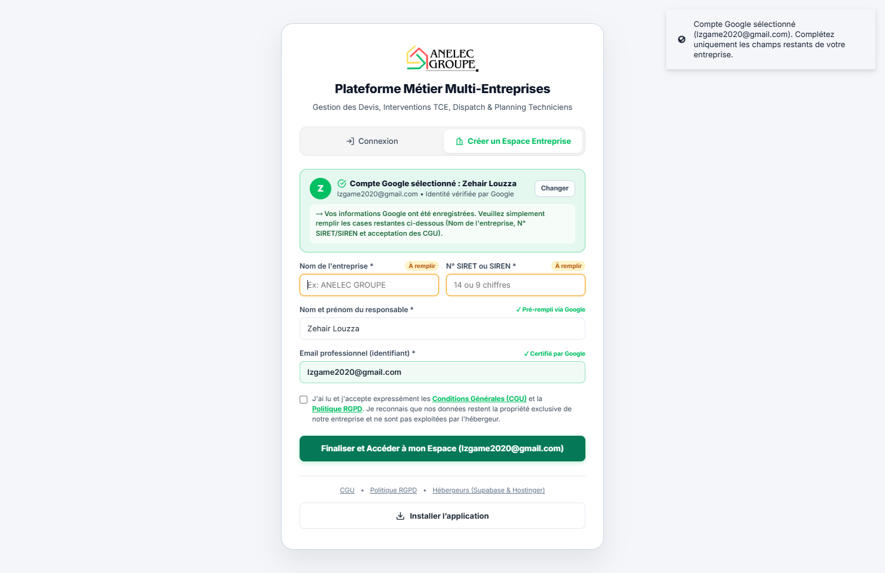
</p>

1. **Étape 1 — Choix du mode d'inscription (`Créer un espace entreprise`) :**
   - Depuis la page d'accueil `/login`, cliquez sur l'onglet **« Créer un espace entreprise »**.
   - **Option A — Inscription Rapide via Google :** Cliquez sur **« Continuer avec Google »** et sélectionnez votre compte Google. Si ce compte n'est pas encore inscrit, l'application **bascule automatiquement sur le formulaire de création de compte** en pré-remplissant votre **Nom complet** et votre **Adresse e-mail professionnelle** validée par Google. Il ne vous reste plus qu'à compléter les champs manquants (**Nom de l'entreprise**, **SIRET/SIREN**, **Mot de passe**) et cocher les CGU.
   - **Option B — Inscription Manuelle :** Saisissez directement la raison sociale de l'entreprise, son numéro **SIRET (14 chiffres)** ou **SIREN (9 chiffres)**, votre nom complet, votre e-mail professionnel et un mot de passe sécurisé (minimum 8 caractères).
2. **Étape 2 — Validation contractuelle CGU & RGPD :**
   - Cochez la case d'acceptation des **Conditions Générales d'Utilisation (CGU)** et de la **Politique de Confidentialité RGPD**, puis cliquez sur **« Créer mon espace entreprise »**.
3. **Étape 3 — Réception de l'E-mail d'Activation & Validation du Compte :**
   - Un e-mail officiel d'activation est immédiatement expédié à l'adresse indiquée (via le serveur SMTP de production `zehair@anelecgroupe.com` avec bascule automatique sur le relais Supabase et lien d'activation de secours).
   - Depuis la bannière de confirmation affichée à l'écran, vous pouvez également cliquer sur **« Renvoyer l'e-mail de confirmation »** ou activer directement votre espace.

<p align="center">
  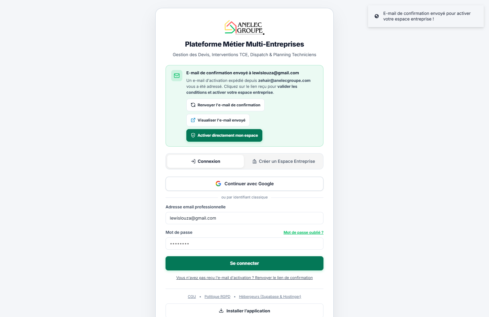
  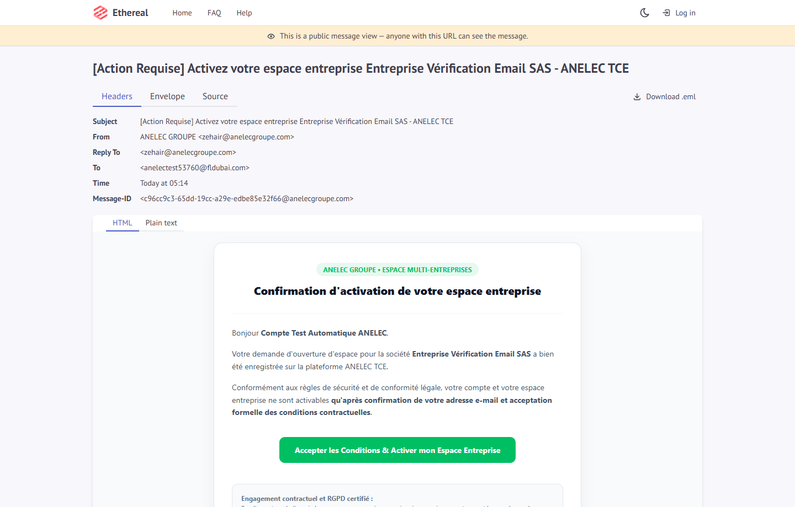
</p>

---

### 1.2 Fonctionnement de la Base de Données Supabase (`PostgreSQL 17`) lors de la Création d'un Compte Entreprise

Chaque création de compte déclenche une transaction structurée dans la base de données **Supabase PostgreSQL 17** afin d'isoler strictement les données de chaque entreprise (**Architecture Multi-Tenant par `companyId`**) :

<p align="center">
  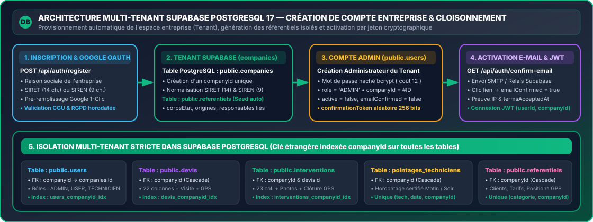
</p>

| Étape Base de Données Supabase | Table PostgreSQL Cible | Opérations Exécutées Automatiquement |
| :--- | :--- | :--- |
| **1. Provisionnement du Tenant Entreprise** | `public.companies` | Vérification et normalisation du **SIRET (14 chiffres)** et du **SIREN (9 chiffres)**. Si l'entreprise n'existe pas encore dans `public.companies`, création d'un nouvel enregistrement avec un identifiant unique `company.id` (`active = true`). |
| **2. Initialisation des Référentiels Métier** | `public.referentiels` | Insertion automatique (`createMany`) des référentiels de base propres à ce `companyId` : **`corpsEtat`** (*Électricité, Plomberie, CVC / Climatisation, Chauffage, Serrurerie, Menuiserie, Peinture, Tous corps d'état*), **`origines`** (*Donneur d'ordre, Client, Contrat de maintenance, Syndic*) et **`responsables`** (pré-initialisé avec le nom du créateur). |
| **3. Création du Compte Administrateur** | `public.users` | Hachage irréversible du mot de passe via **`bcrypt` (12 rounds)**. Création de l'utilisateur avec `role = 'ADMIN'`, rattaché par clé étrangère `companyId = company.id`, statut initial `active = false`, `emailConfirmed = false`, et génération d'un jeton cryptographique unique `confirmationToken` de **256 bits** (`crypto.randomBytes(32)`). |
| **4. Certification & Preuve Légale RGPD** | `public.users` | Lors du clic sur le lien de confirmation (`GET /api/auth/confirm-email?token=...`), mise à jour atomique dans Supabase : `active = true`, `emailConfirmed = true`, `confirmationToken = NULL`, enregistrement de la date exacte `termsAcceptedAt = NOW()` et de l'adresse IP `termsAcceptedIp`. |
| **5. Cloisonnement Strict des Données (Isolation Multi-Tenant)** | `devis`, `interventions`, `pointages_techniciens`, `referentiels`, `users` | Le jeton JWT délivré à la connexion embarque `{ userId, email, role, companyId }`. Toutes les requêtes SQL générées par Prisma appliquent systématiquement le filtre indexé `WHERE "companyId" = req.user.companyId`. **Aucune entreprise ne peut voir ni modifier les devis, interventions, techniciens, tarifs ou pointages d'une autre entreprise.** |

---

## 2. Vue d'Ensemble & Cycle Opérationnel TCE

La plateforme **Suivi TCE ANELEC** fédère en temps réel l'ensemble de la chaîne opérationnelle : de la réception du besoin client (Syndics, Bailleurs, Donneurs d'ordre B2B, Clients B2C), en passant par le chiffrage et la visite technique, le planning Gantt, l'optimisation de tournée GPS, l'application mobile technicien, jusqu'à la facturation et l'analyse de rentabilité.

<p align="center">
  
</p>

---

## 3. Tableau de Bord & Pilotage d'Activité (CA, Volume & Filtres Temporels)

Le **Tableau de Bord** offre une lecture instantanée de la santé opérationnelle et financière de l'entreprise grâce à ses **3 volets métier** (*Synthèse*, *Opérations*, *Analyse*) et son module de **Suivi d'Activité & Chiffre d'Affaires par Donneur d'Ordre** :

<p align="center">
  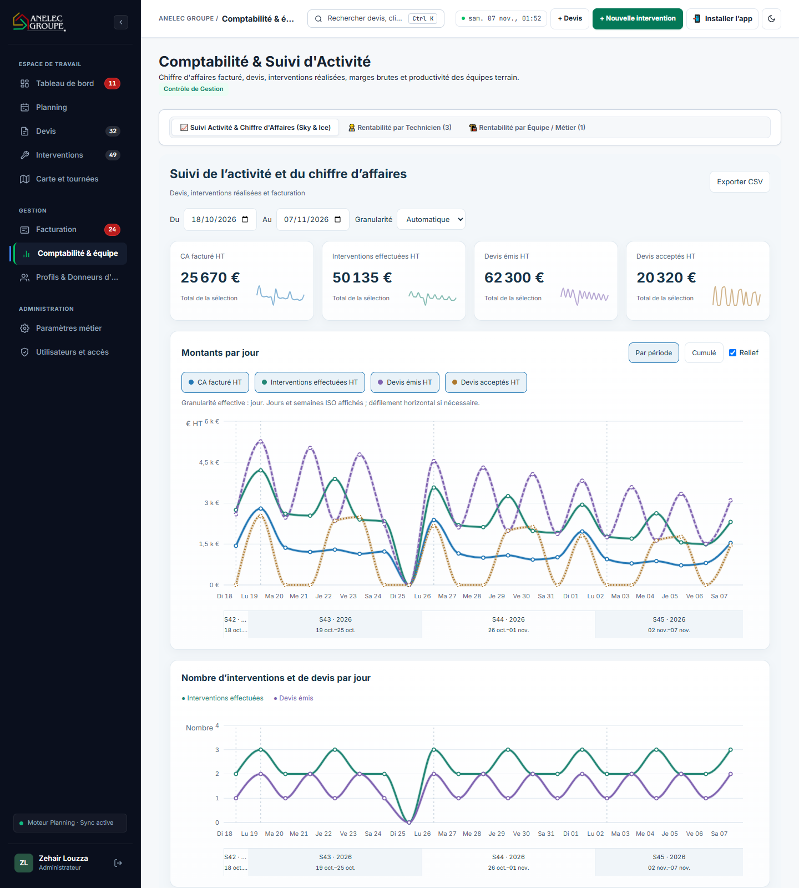
  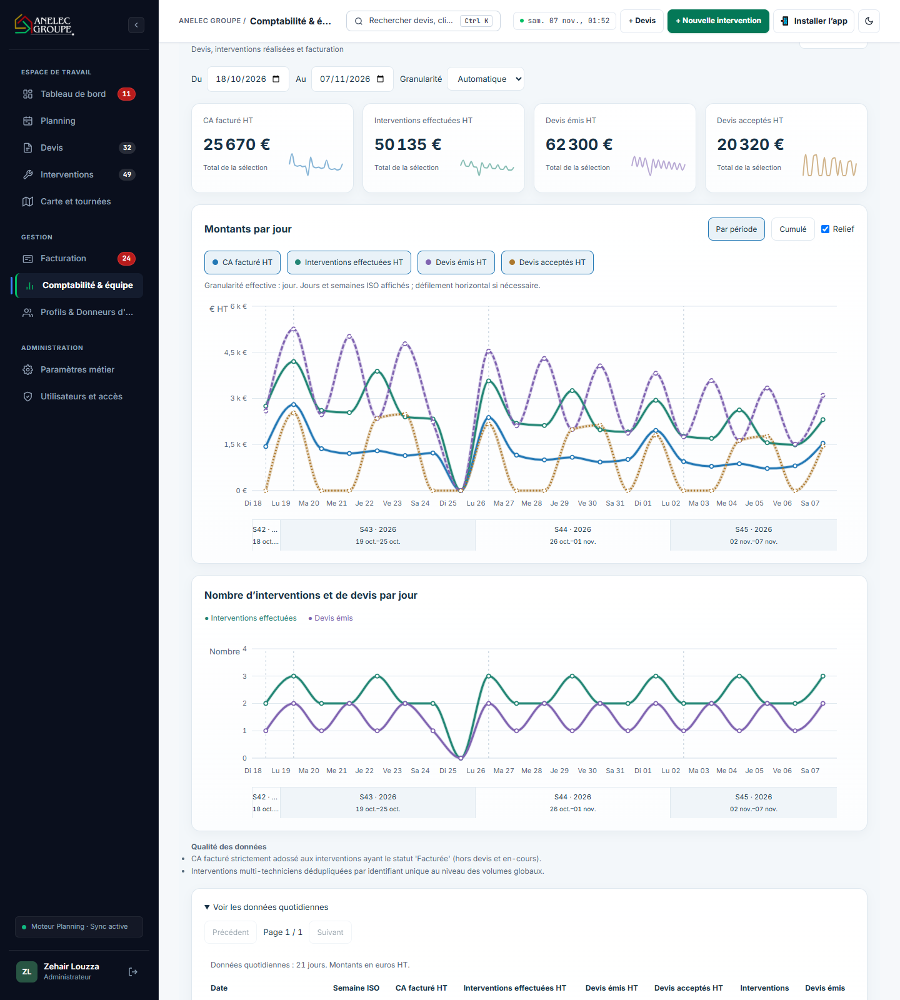
</p>

* **4 Cartes Financière & Opérationnelle en En-tête :**
  1. **CA Global HT :** Chiffre d'affaires total généré sur la période sélectionnée.
  2. **CA Facturé HT :** Montant HT des chantiers déjà facturés.
  3. **Reste à Facturer HT :** Trésorerie immédiatement facturable sur les chantiers terminés.
  4. **Panier Moyen HT :** Montant moyen par intervention et taux d'achèvement global.
* **Filtres Temporels Granulaires :** Filtrage instantané par **Année**, **Mois**, **Jour précis** et **Donneur d'Ordre**, avec bascule entre la vue **Chiffre d'Affaires (€)** et la vue **Volume d'Activité (Quantités)**.

---

## 4. Extraction « Situation Excel » Multi-Clients avec Dates de Début et de Fin

Depuis la barre supérieure globale, l'espace **Devis** ou l'espace **Interventions**, le bouton **« Situation Excel »** ouvre le générateur de rapports comptables et opérationnels :

<p align="center">
  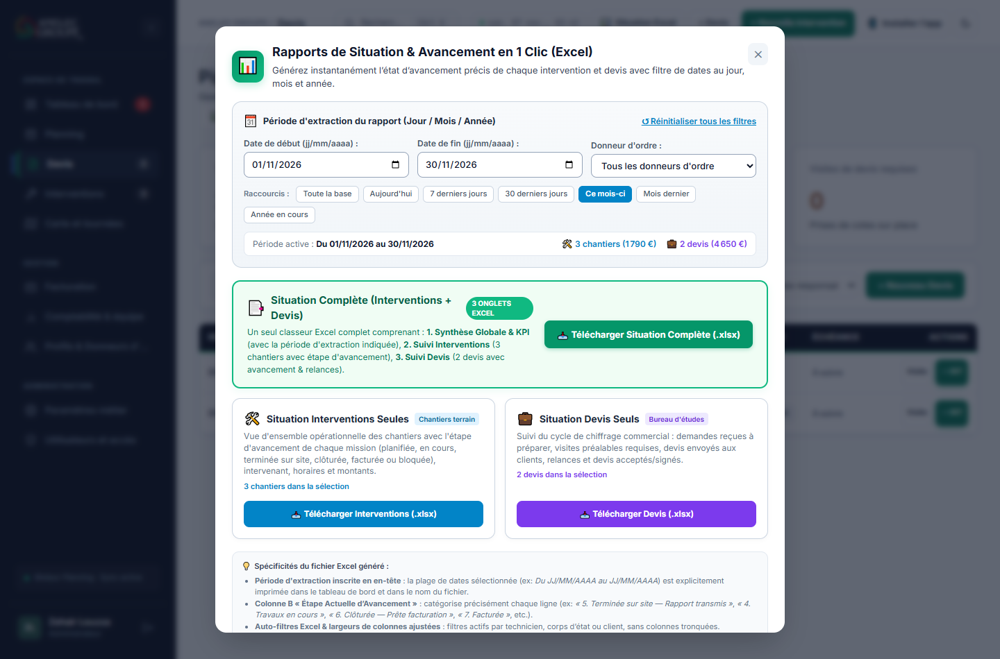
</p>

* **Plage de Dates Exacte (`Du JJ/MM/AAAA` → `Au JJ/MM/AAAA`) :**
  - Sélectionnez la **Date de début (Jour / Mois / Année)** et la **Date de fin (Jour / Mois / Année)** pour extraire uniquement les dossiers de la période voulue.
  - Raccourcis rapides en 1 clic : *Aujourd'hui*, *Ce mois-ci*, *Cette année*, ou *Toutes les dates*.
* **Sélection Multi-Clients par Cases à Cocher :**
  - Cochez un donneur d'ordre unique, plusieurs clients simultanément, ou **Tous les donneurs d'ordre** pour générer un classeur Excel `.xlsx` multi-onglets prêt à être transmis au client ou au cabinet comptable.

---

## 5. Pipeline Devis (22 Colonnes), Visites Techniques & Reconversion Sécurisée

Le module **Devis** centralise toutes les demandes de chiffrage sur 22 colonnes normalisées :

<p align="center">
  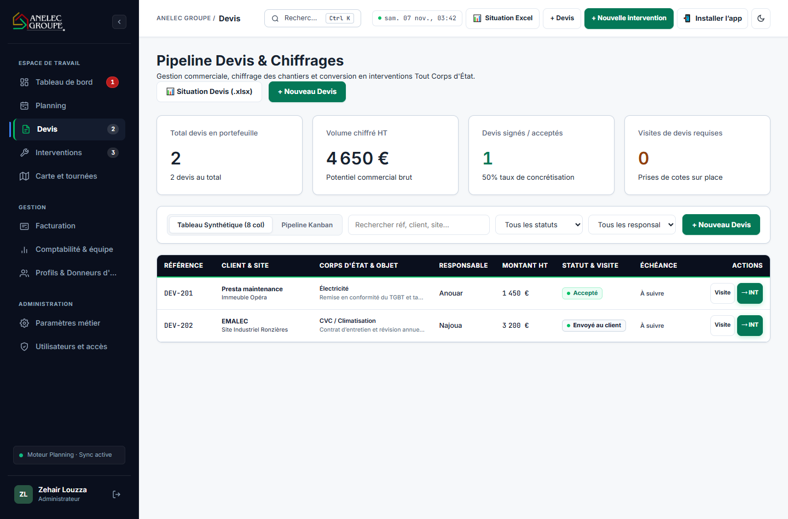
</p>

1. **Création & Visite Technique Préalable (`VIS • DEV`) :**
   - Lors de la création d'un devis (`+ Devis`), si une visite sur place est requise pour relever les métrés, cochez **« Visite nécessaire »** et affectez un technicien : une mission de visite technique est automatiquement créée et synchronisée avec le planning et l'application mobile du technicien.
2. **Envoi du Devis par E-mail au Client :**
   - Envoyez la proposition commerciale directement par e-mail au donneur d'ordre avec suivi automatique dans l'historique du devis.
3. **Conversion en Intervention & Grille Anti-Doublon :**
   - Dès acceptation du devis, convertissez-le en intervention en 1 clic sans écraser le devis d'origine. En cas de reconversion (SAV, Reprise, Avenant, 2ème Phase), la grille intelligente qualifie le motif.

---

## 6. Suivi des Interventions TCE (23 Colonnes) & Envoi de Rapports Officiels par E-mail

Le module **Interventions** assure le suivi opérationnel complet des travaux et visites techniques :

<p align="center">
  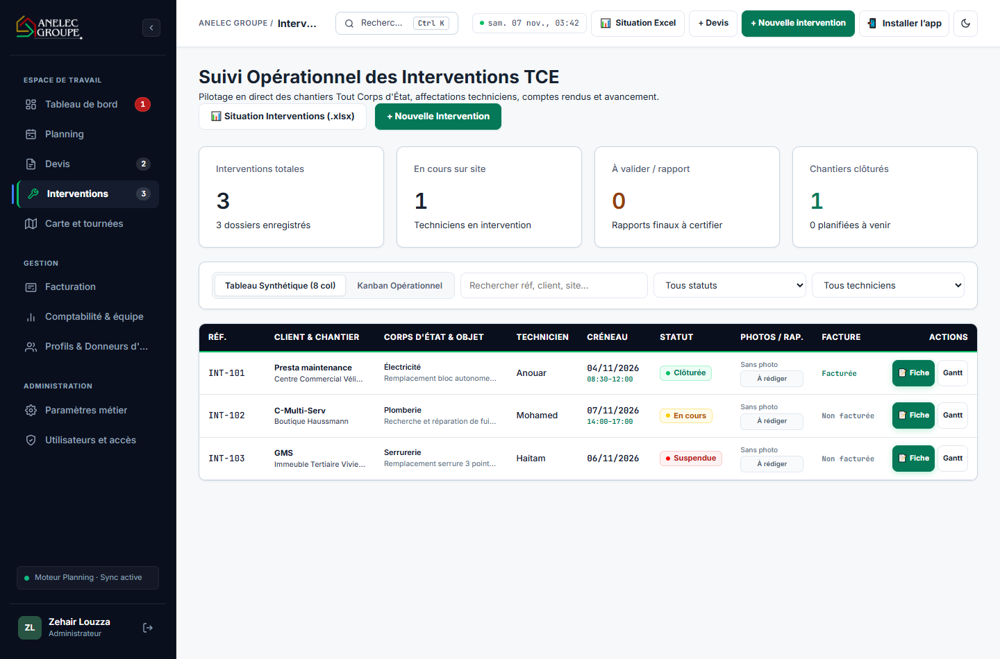
  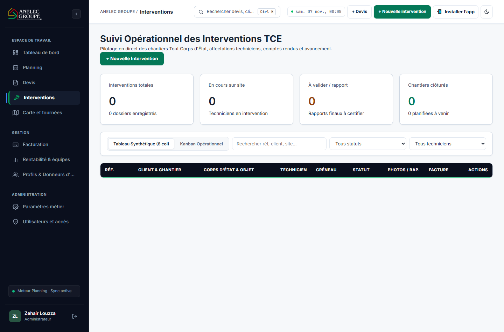
</p>

* **Suivi Temps Réel :** Statuts opérationnels (*À planifier, Planifiée, En cours, Intervention non terminée, Clôturée*), heures réelles de début et de fin, éléments de chiffrage et photos avant/après.
* **Rapport Officiel PDF & Envoi par E-mail (Réservé à l'équipe bureau) :** Génération du rapport d'intervention certifié avec photos et envoi direct par e-mail au donneur d'ordre.

---

## 7. Planning Gantt Multi-Ressources (60 fps) & Bourse de Dispatch

Le **Planning Gantt** permet aux conducteurs de travaux et dispatchers d'organiser les journées des techniciens par simple glisser-déposer :

<p align="center">
  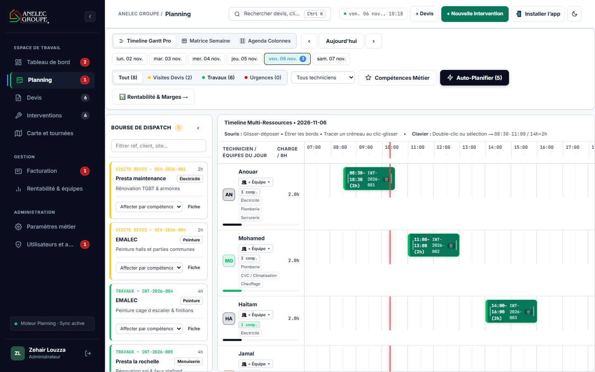
</p>

* **Bourse de Dispatch Latérale :** Liste des interventions et visites devis en attente de planification.
* **Glisser-Déposer & Redimensionnement Horaire :** Affectez une mission à un technicien ou une équipe binôme et ajustez sa durée directement à la souris.

---

## 8. Application Mobile Technicien (PWA), 4 Onglets Tactiles, Clôture GPS & 7 Directions Artistiques

L'**application mobile terrain** (PWA installable sur iOS et Android) accompagne le technicien de sa prise de service le matin jusqu'à la clôture certifiée de ses interventions. Entièrement réarchitecturée pour une utilisation optimale à une main (zone du pouce), elle s'articule autour de **4 onglets tactiles**, intègre le **sélecteur des 7 Directions Artistiques** et certifie chaque étape par géolocalisation.

<p align="center">
  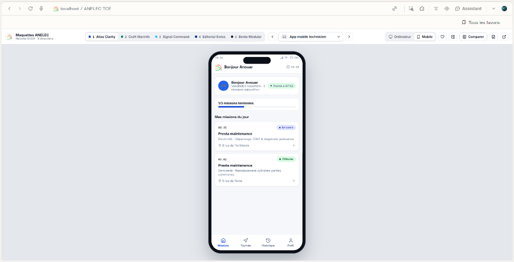
  
  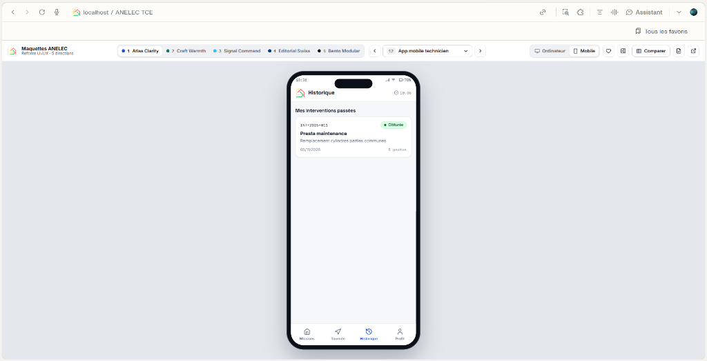
  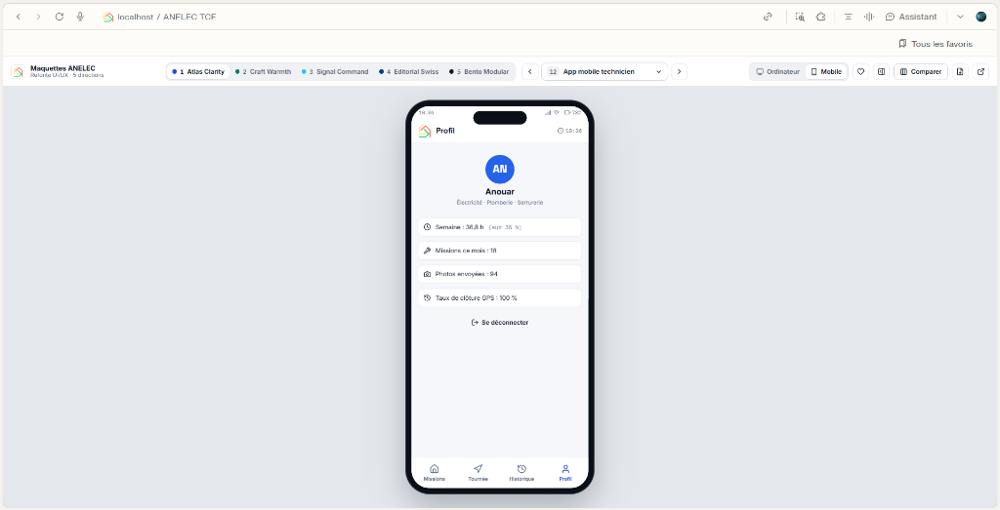
</p>

<p align="center">
  <em>Figure 8.1 : Les 4 écrans natifs de l'App Mobile Technicien (Missions, Ma Tournée, Historique, Profil & 7 Thèmes).</em>
</p>

### 8.1 Les 4 Onglets de l'Application Mobile

1. **Onglet « Missions » (Accueil & Prise de Service) :**
   - **Barre de statut smartphone native :** Affichage de l'heure en temps réel, indicateurs réseau et batterie.
   - **En-tête épuré :** Logomark ANELEC et salutation dynamique (*« Bonjour [Nom] »*).
   - **Carte d'accueil & Pointage Inviolable 1-Clic :** Avatar circulaire avec initiales, date du jour et décompte des chantiers assignés. Un bouton tactile **« Pointer mon arrivée »** horodate immédiatement la présence en base PostgreSQL (`pointages_techniciens`) et bascule en pastille verte **`● Pointé à [HH:MM]`**. Le démarrage des chantiers est verrouillé tant que ce pointage n'est pas effectué.
   - **Jauge de progression journalière :** Barre d'avancement visuelle en direct (ex. *« 1/3 missions terminées »*).
   - **Cartes des missions du jour :** Créneau horaire, pastille de statut colorée (*En cours*, *Clôturée*, *Prévu*), nom du client ou bailleur, corps d'état & objet de la prestation, et adresse avec chevron tactile.

2. **Onglet « Ma tournée » (Carte Schématique & Ordre des Arrêts) :**
   - **Visualisation cartographique stylisée :** Repérage instantané de la position du technicien (initiales dans un cercle bleu) et des étapes numérotées `1`, `2`, `3` reliées visuellement sur la trame de tournée.
   - **Ordonnancement séquentiel des arrêts :** Liste ordonnée sous la carte indiquant chaque arrêt avec son créneau horaire, son adresse et son badge de statut (*En cours*, *Suivant*, *Prévu*).

3. **Onglet « Historique » (Chantiers Clôturés) :**
   - **Archives des interventions passées :** Liste chronologique des chantiers terminés.
   - **Cartes récapitulatives :** Référence métier officielle (`INT-2026-xxx`), pastille verte `● Clôturée`, nom du client, descriptif des travaux réalisés, date formatée et compteur de photos certifiées.

4. **Onglet « Profil » & Sélecteur des 7 Directions Artistiques :**
   - **Avatar grand format (64px) & Spécialités :** Profil du technicien avec corps d'état assignés (*Électricité • Plomberie • Serrurerie*).
   - **4 KPI d'activité en temps réel :**
     1. *Heures effectuées dans la semaine (avec repère légal 35 h)*
     2. *Missions accomplies dans le mois*
     3. *Photos d'intervention envoyées*
     4. *Taux de clôture GPS : 100 %*
   - **Sélecteur interactif des 7 Thèmes :** Le technicien peut changer l'apparence complète de son application en 1 tap parmi :
     * **1. Atlas Clarity** (Mode SaaS épuré, blanc éclatant, bleu roi)
     * **2. Craft Warmth** (Palette artisanale chaleureuse, tons sable & ambre)
     * **3. Signal Command** (Ambiance cockpit sombre haute lisibilité)
     * **4. Editorial Swiss** (Typographie helvétique rigoureuse et contrastée)
     * **5. Bento Modular** (Grille modulaire géométrique aux accents ANELEC)
     * **6. Original Clair** & **7. Original Sombre** (Thèmes historiques de la plateforme)
   - **Bouton de déconnexion sécurisé :** « Se déconnecter ».

---

### 8.2 Fiche Détail de Mission & Clôture GPS Inviolable

En touchant n'importe quelle carte de mission, le technicien bascule sur la vue d'intervention détaillée plein écran :

<p align="center">
  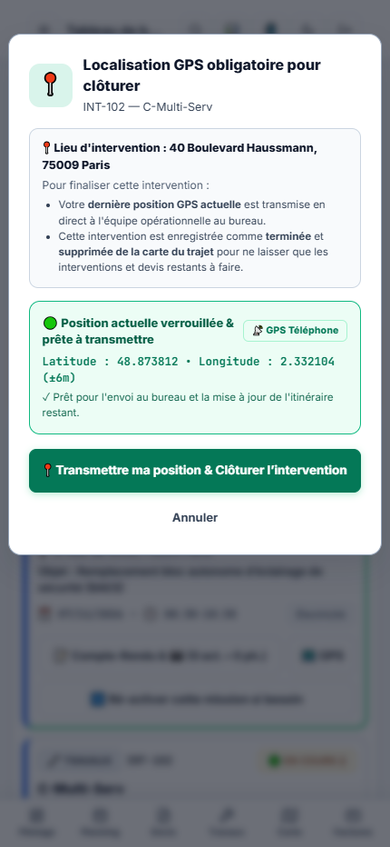
  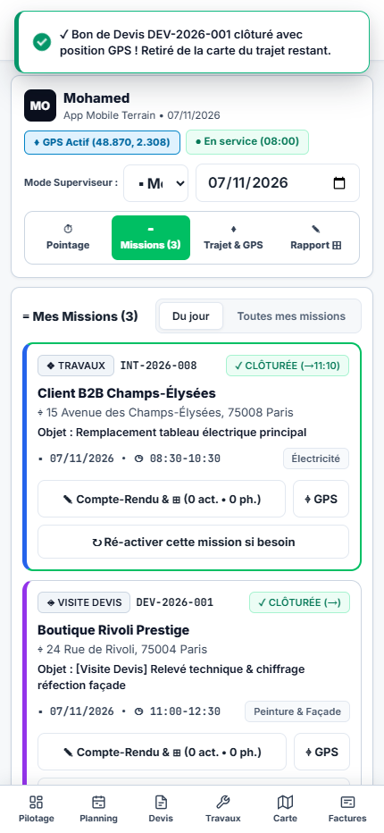
</p>

* **Tuiles Métriques du Chantier :** Créneau horaire planifié, Montant estimé HT et Durée indicative.
* **Actions Rapides d'Accès :** Bouton **[Itinéraire]** ouvrant instantanément l'application GPS native du smartphone (Google Maps, Waze, Apple Plans) et bouton **[Appeler]** composant directement le numéro du contact sur site.
* **Consignes d'Accès & Sécurité :** Digicodes, étage, porte, consignes particulières transmises par le donneur d'ordre.
* **Photos Avant / Après avec Compression Locale Automatique (< 75 Ko) :** Galerie de vignettes et bouton d'ajout ouvrant la caméra mobile avec optimisation et réduction de poids instantanées côté client avant téléversement.
* **Compte-Rendu & Rapport d'Intervention :** Zone de saisie libre des observations et travaux réalisés.
* **Barre d'Actions Flottante Accessible au Pouce :** Boutons tactiles `[Démarrer sur site]`, `[Mettre en pause]` et `[Clôturer avec GPS]`.
* **Certification GPS & Retrait Immédiat de la Carte :**
  - La clôture d'une **Intervention (`INT-...`)** ou d'un **Bon de Devis / Visite Devis (`DEV-...` / `VIS-...`)** déclenche l'acquisition de la position géographique avec calcul du rayon de précision en mètres.
  - La position est transmise au bureau et **la mission est automatiquement retirée de la carte générale des tournées** pour ne laisser que le reste à faire.
  - Une confirmation nette sur **fond blanc 100 % opaque** s'affiche sans aucun chevauchement et disparaît après 2,5 secondes.

---

## 9. Carte Interactive, Positions Actuelles vs Trajet Restant & Mode Plein Écran PC

Le module **Carte et tournées** (`/carte`) offre au bureau opérationnel comme au technicien une visibilité complète en temps réel :

<p align="center">
  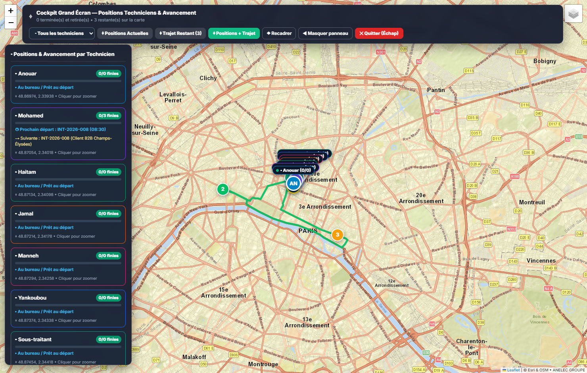
  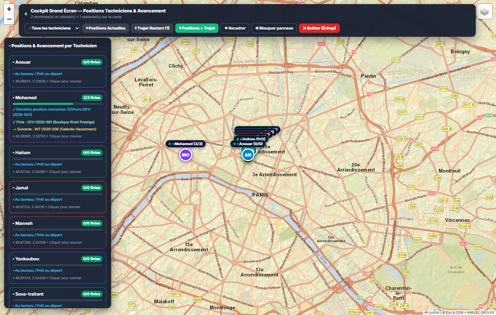
</p>

* **Retrait Automatique des Missions Terminées :**
  - Dès qu'une intervention ou un bon de devis est déclaré terminé sur mobile, son marqueur d'étape est **retiré de la carte**, le compteur d'avancement du technicien est incrémenté (ex. `2/3 finies (67%)`) et le trajet routier est recalculé uniquement sur les étapes restantes.
* **3 Modes d'Affichage au Choix :**
  1. **`⌖ Positions Actuelles Techniciens` :** Affiche uniquement la dernière position GPS transmise par chaque technicien.
  2. **`→ Afficher le Trajet Restant` :** Affiche uniquement les étapes restantes à réaliser et le tracé routier optimisé.
  3. **`❖ Les Deux (Positions + Trajet)` :** Combine les positions actuelles des techniciens et l'itinéraire des missions restantes.
* **Mode Cockpit Plein Écran PC :** Le bouton **`⛶ Plein Écran PC`** agrandit la carte sur 100 % de l'écran avec un panneau latéral de suivi d'avancement en direct par technicien.

---

## 10. Studio Facturation & Relation Client (5 Bacs B2B/B2C & Diagnostic Retards)

L'espace **Facturation** (`/facturation`) structure le contrôle financier et la communication client :

<p align="center">
  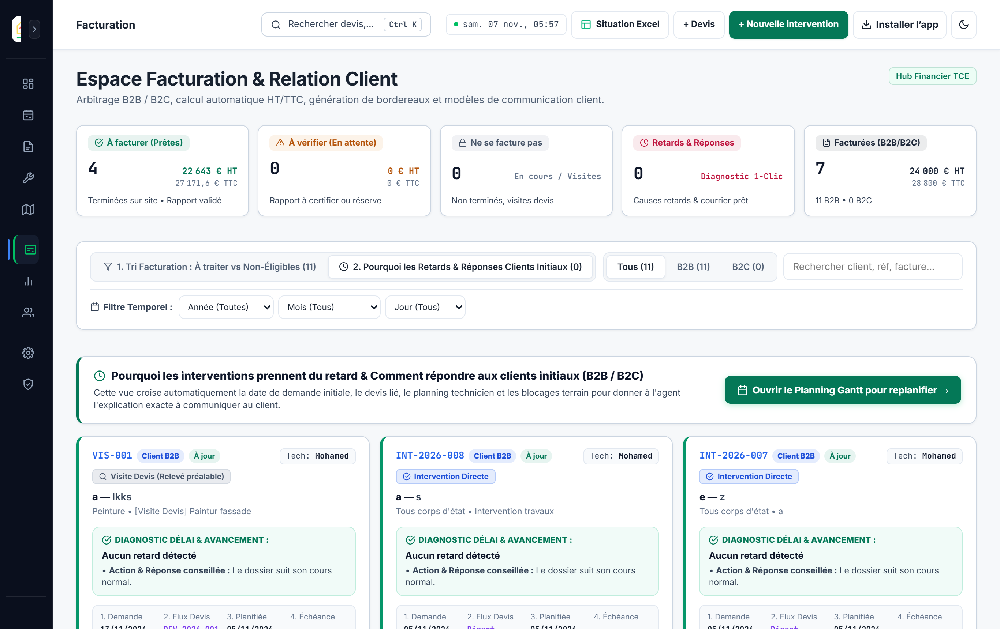
  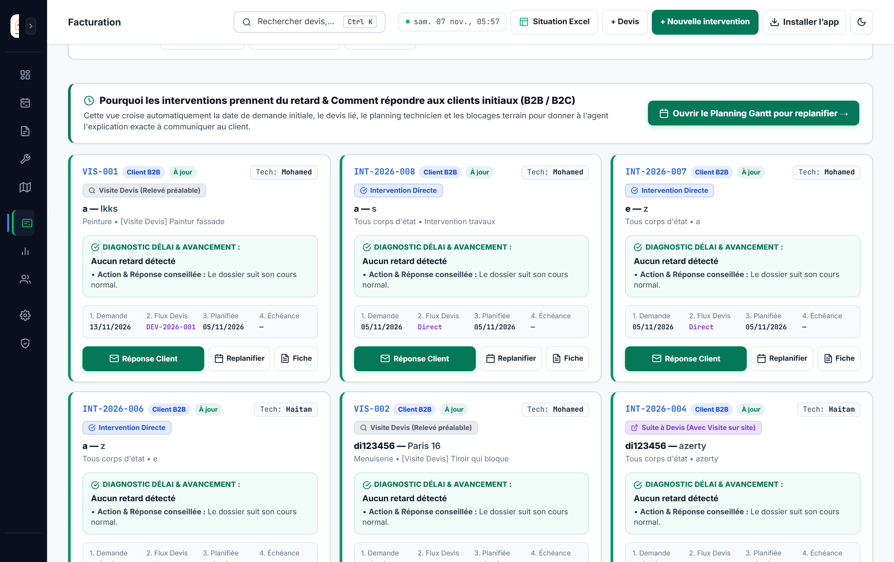
</p>

* **5 Bacs de Tri Intelligents :** *À facturer (Prêtes)*, *À vérifier (En attente)*, *Non éligibles (En cours / Visites)*, *Retards & Relances (Diagnostic 1-Clic)* et *Facturées (B2B / B2C)*.
* **Arbitrage Fiscal B2B / B2C :** Calcul automatique HT/TTC (autoliquidation B2B 0%, TVA 20%, TVA réduite B2C 10% et 5,5%).
* **Diagnostic des Retards & Générateur de Réponse Client Initial :** Analyse automatique de la cause d'un retard ou blocage terrain et génération en 1 clic du courrier de réponse destiné au client.

---

## 11. Profils Donneurs d'Ordre, Rentabilité Équipes & Administration SMTP

<p align="center">
  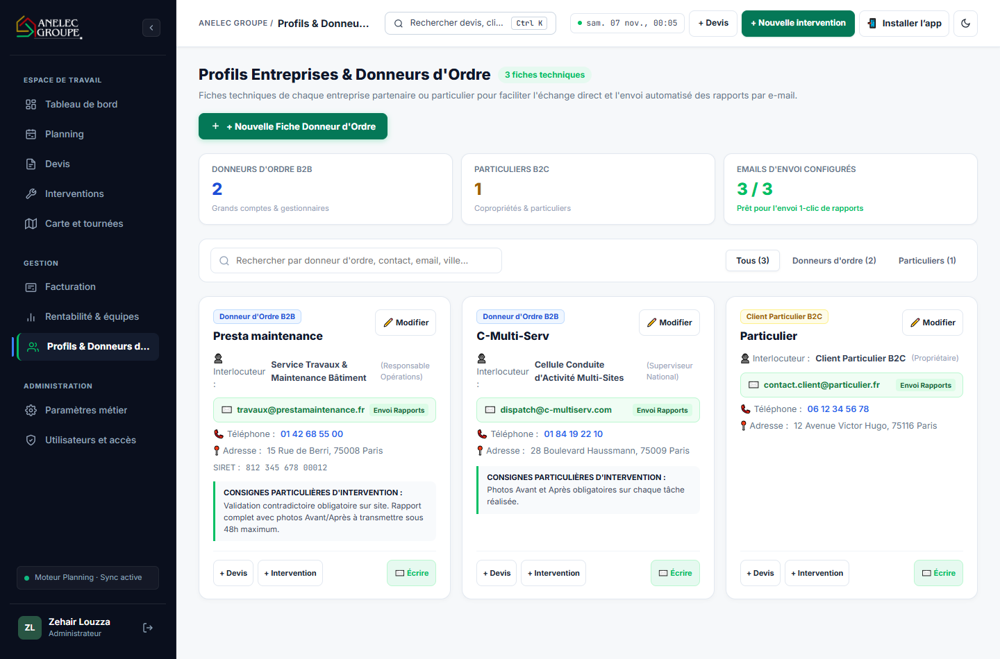
  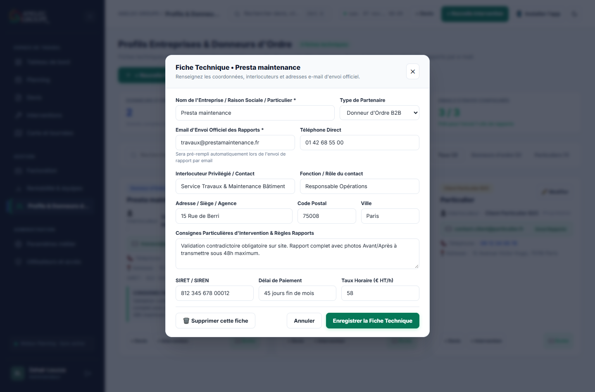
  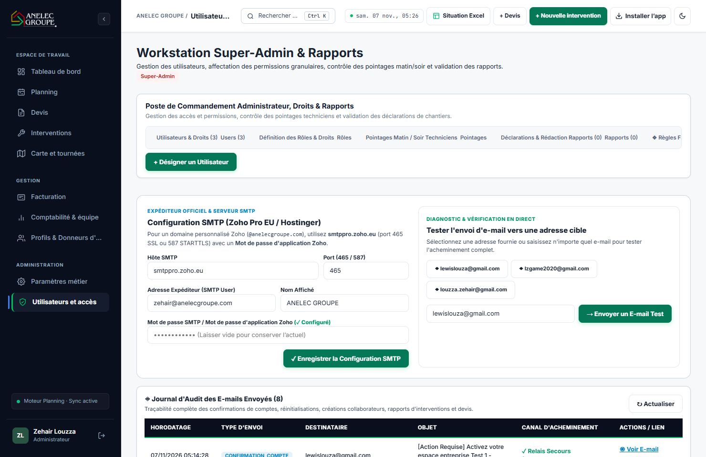
</p>

* **Profils & Donneurs d'Ordre :** Répertoire complet des syndics, bailleurs et clients B2B/B2C avec fiche technique détaillée (SIRET, contacts, délais contractuels, grille tarifaire par corps d'état et historique financier).
* **Comptabilité & Rentabilité Équipes :** Calcul de la rentabilité horaire réelle (€ HT / heure pointée) et simulateur de coût horaire chargé.
* **Utilisateurs, Accès & Supervision E-mails SMTP :** Gestion des comptes et permissions par rôle (`ADMIN`, `USER`, `TECHNICIEN`), création directe de comptes pré-activés, audit des pointages et panneau de test/diagnostic SMTP en temps réel.

---

## 12. Génération du Guide PDF Complet & Commandes Techniques

### Générer le Manuel Utilisateur & Guide de Création de Compte au Format PDF

```sh
# Générer le document PDF complet illustré (docs/GUIDE_UTILISATEUR_PROCEDURES_ANELEC_TCE.pdf)
node scripts/generate-doc-pdf.mjs
```

### Commandes de Développement & Production

```sh
# 1. Installation des dépendances
npm ci --include=dev

# 2. Lancement en développement local
npm run dev

# 3. Compilation complète de production (Client Vite + Serveur TypeScript)
npm run build

# 4. Application des migrations PostgreSQL / Supabase
node scripts/migrate.mjs
```

---

© **ANELEC GROUPE** — 9 Rue des Colonnes, 75002 Paris. Tous droits réservés.
